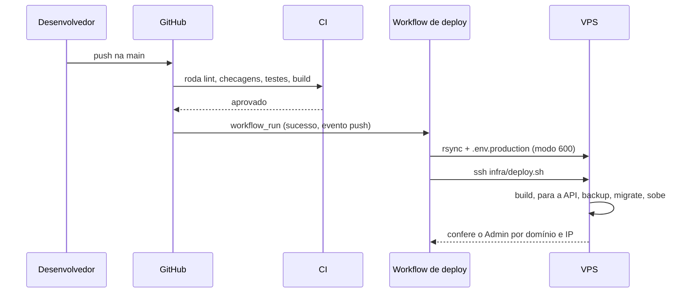

# Design — Base do projeto

## 1. Visão geral
Uma API Django com DRF e PostgreSQL, empacotada numa imagem única, publicada na VPS compartilhada pelo
Traefik central. O CI valida cada commit; só um commit aprovado na `main` dispara o deploy, que faz
backup, migra e confere pelo HTTPS público. Nesta mudança só o Admin do Django e seus estáticos são públicos.

## 2. Reuso e impacto
| Existente (caminho) | Uso nesta mudança |
|---|---|
| `sistema-vinculus/.github/workflows/deploy.yml` e `infra/deploy.sh` | modelo do pipeline, simplificado (sem SILO, sem cron, sem usuários padrão) |
| `sistema-vinculus/docker-compose.deploy.yml` | modelo dos rótulos do Traefik e dos nomes únicos |
| `traefikproxy` | proxy, certificados e rede `traefik_proxy` (não é alterado) |

Capacidades de `specs/system/` afetadas: nenhuma ainda (a spec viva `base` nasce no arquivamento).

## 3. Pesquisa
| Dúvida | Fonte (doc oficial da versão) | Conclusão |
|---|---|---|
| `check --deploy` aceita `--fail-level WARNING` | Django 5.2, comando `check` | usado no CI para bloquear avisos de produção |
| WhiteNoise com `CompressedManifestStaticFilesStorage` exige `collectstatic` | WhiteNoise 6.12 | feito no build da imagem |

## 4. Modelo de dados
Nenhuma tabela de domínio. Só as tabelas padrão do Django (usuários, sessões, Admin), criadas por `migrate`.
Migração: reversível e sem volume; nada a preservar.

## 5. Contratos
Fonte formal: `contracts/openapi.yaml`.

| Operação | Auth | Permissão | Entrada | Saída | Erros | Limites |
|---|---|---|---|---|---|---|
| `GET /api/v1/health` | nenhuma | pública (única) | — | `{"status": "ok", "versao": "0.1.0"}` | 500 quando o banco não responde | sem limite nesta fase |

## 6. Fluxos e estados de UI
Sem interface própria. O Admin do Django é a única tela pública.

## 7. Tratamento de erros
- O health faz uma consulta mínima; se o banco falhar, a exceção sobe e a resposta é 500 (fail-closed).
- `deploy.sh` roda com `set -euo pipefail`: qualquer falha interrompe e **deixa a API parada** para inspeção.
  Nunca serve código novo com banco pela metade.
- O workflow aborta se algum segredo estiver vazio ou com quebra de linha.

## 8. Propriedades de corretude
- **PROP-1** Para qualquer rota registrada em `config.api_v1`, se a rota aceita requisição sem autenticação, ela consta na lista de rotas públicas declarada. — valida: NFR-SEC-1

## 9. Segurança (resumo — detalhe em threat-model.md)
Controles: CTL-1 deploy só após CI aprovado; CTL-2 segredos fora do Git e do rsync; CTL-3 produção sem chave de
desenvolvimento; CTL-4 nomes únicos na rede compartilhada; CTL-5 permissão padrão negada; CTL-6 API parada
antes das migrações; CTL-7 chave SSH dedicada e revogável.

## 10. Estratégia de testes
| ID | Nível | Teste planejado |
|---|---|---|
| REQ-1.1 | integração (banco real) | `test_req_1_1_health_responde_ok_sem_login` |
| REQ-1.2 | integração | `test_req_1_2_health_falha_quando_banco_nao_responde` |
| REQ-2.1, CTL-3 | unidade (processo isolado) | `test_req_2_1_producao_recusa_subir_sem_secret_key` |
| NFR-SEC-1, PROP-1, CTL-5 | unidade | `test_prop_1_rotas_sem_login_estao_na_lista_publica` |
| ABU-1, CTL-1 | contrato do pipeline (leitura do workflow) | `test_abu_1_deploy_so_apos_ci_aprovado_na_main` |
| ABU-2, CTL-2, NFR-SEC-2 | contrato do pipeline | `test_abu_2_deploy_aborta_sem_segredo`, `test_ctl_2_segredos_fora_do_rsync` |
| ABU-3 | contrato do pipeline | `test_abu_3_deploy_confere_rede_antes_de_parar_a_api` |
| REQ-3.5, CTL-6 | contrato do pipeline | `test_req_3_5_backup_antes_das_migracoes` |
| REQ-3.6 | contrato do pipeline | `test_req_3_6_guarda_so_os_10_backups_mais_novos` |
| REQ-3.1 | evidência | primeira execução do CI no GitHub |
| REQ-3.2, REQ-3.3, REQ-3.4 | evidência | primeira execução do deploy e `curl` registrados na validação |
| REQ-4.1 | evidência | `docker compose up --build` e `curl localhost:8010/api/v1/health` |
| CTL-4, CTL-7 | revisão | compose de produção e `authorized_keys` conferidos na validação |

Os testes "de contrato do pipeline" leem `.github/workflows/*.yml` e `infra/deploy.sh` como texto: provam que a
regra está escrita, não que a VPS a cumpre. A prova de funcionamento é a evidência do primeiro deploy.

## 11. Observabilidade
Logs do gunicorn e do Django em texto na saída padrão, sem corpo de requisição. O health serve de sonda para o
`HEALTHCHECK` da imagem. Sem PII nos logs (não há dado pessoal nesta fase).

## 12. Decisões
- **D-1** Layout padrão da skill (`specs/steering`, `system`, `changes`) · alternativa: layout leve do Vinculus · motivo: projeto novo, módulos e ameaças de privacidade pedem spec viva e threat model · consequência: mais arquivos por feature P2.
- **D-2** Sessão do Django, não JWT (ADR-0004) · motivo: duas pessoas, sem papéis · consequência: CSRF obrigatório.
- **D-3** Deploy na VPS compartilhada sob `/entrelinhas` (ADR-0003) · consequência: depende da rede `traefik_proxy`.
- **D-4** Visibilidade filtrada no servidor (ADR-0002) · consequência: um único ponto de leitura de registros.
- **D-5** Stack igual à do Vinculus (ADR-0001) · consequência: nenhuma dependência nova sem ADR.

## 13. Portões da constituição
| Portão | ✔/✘ | Justificativa |
|---|---|---|
| Simplicidade | ✔ | um serviço de API e um banco; sem cron, sem fila, sem armazenamento de arquivos |
| Anti-abstração | ✔ | Django e DRF usados diretamente |
| Teste primeiro | ✔ | testes de health e de configuração escritos junto do código; testes de contrato do pipeline escritos depois (registrado na validação) |
| Integração real | ✔ | PostgreSQL real nos testes e no CI |
| Segurança | ✔ | threat-model.md com 7 ameaças e 7 controles |
| Reuso | ✔ | pipeline e compose copiados do padrão do Vinculus |

## 14. Rastreamento de complexidade
| Exceção | Por que é necessária | Alternativa simples rejeitada |
|---|---|---|
| Testes que leem os workflows como texto | os controles de pipeline não têm outro teste automático antes do primeiro deploy | confiar só em revisão humana |

## 15. Riscos e rollback
- Deploy parcial: a API fica parada; restaurar com o backup mais recente em `~/backups/project-entrelinhas`
  (`pg_restore`) e reexecutar o workflow manualmente.
- Reverter a mudança: remover o diretório `~/project-entrelinhas` e os contêineres `project-entrelinhas-*` na VPS;
  nada em outros projetos é alterado.
