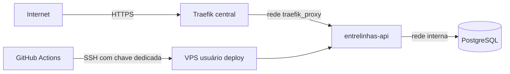

# Modelo de ameaças — Base do projeto

## Ativos e dados
| Ativo | Classificação | Por que importa |
|---|---|---|
| Chave SSH de deploy | segredo | entrar na VPS como `deploy` dá controle sobre os outros projetos da mesma máquina |
| `DJANGO_SECRET_KEY` | segredo | assina sessões; com ela, sessões podem ser forjadas |
| `POSTGRES_PASSWORD` | segredo | acesso ao banco |
| Backups do banco | interno (hoje vazios de dado pessoal) | passam a conter texto íntimo nas próximas mudanças |
| Código-fonte e workflows | interno | quem altera o workflow executa código na VPS |

## Fronteiras de confiança e fluxo de dados

## Ameaças (STRIDE por fluxo)
| ID | Fluxo | STRIDE | Ameaça | Prob. | Impacto | Risco | Controle(s) |
|---|---|---|---|---|---|---|---|
| THR-1 | GitHub → VPS | T | publicar código que não passou no CI | M | A | A | CTL-1 |
| THR-2 | repositório e rsync | I | segredo ou `.env` vai para o Git ou para a VPS errada | M | A | A | CTL-2 |
| THR-3 | produção | S | produção sobe com a chave de desenvolvimento e sessões são forjadas | B | A | M | CTL-3 |
| THR-4 | rede `traefik_proxy` | T | serviço com nome genérico responde no lugar de outro projeto | M | M | M | CTL-4 |
| THR-5 | API | E | rota criada sem autenticação por esquecimento | M | A | A | CTL-5 |
| THR-6 | deploy | D | falha no meio serve código novo com banco antigo | M | M | M | CTL-6 |
| THR-7 | chave SSH | E | vazamento da chave de deploy | B | A | M | CTL-7 |

## Controles
| ID | Controle | Atende | Teste/evidência |
|---|---|---|---|
| CTL-1 | o workflow de deploy só roda após o CI com sucesso em evento de push na `main` (`if:` do job) | THR-1, ABU-1, REQ-3.2 | `test_abu_1_deploy_so_apos_ci_aprovado_na_main` |
| CTL-2 | `.env*` no `.gitignore`; rsync exclui `.env*`; `.env.production` é gerado na VPS com modo 600 | THR-2, NFR-SEC-2, ABU-2 | `test_ctl_2_segredos_fora_do_rsync`, `test_abu_2_deploy_aborta_sem_segredo` |
| CTL-3 | `prod.py` lê `DJANGO_SECRET_KEY` sem valor padrão | THR-3, REQ-2.1 | `test_req_2_1_producao_recusa_subir_sem_secret_key` |
| CTL-4 | serviços e aliases na rede compartilhada com prefixo `entrelinhas-` | THR-4 | revisão do `docker-compose.deploy.yml` na validação |
| CTL-5 | permissão padrão `IsAuthenticated`; rota pública declarada e listada | THR-5, NFR-SEC-1 | `test_prop_1_rotas_sem_login_estao_na_lista_publica` |
| CTL-6 | `deploy.sh` com `set -euo pipefail`; confere a rede e para a API antes do backup e das migrações | THR-6, ABU-3, REQ-3.5 | `test_abu_3_deploy_confere_rede_antes_de_parar_a_api`, `test_req_3_5_backup_antes_das_migracoes` |
| CTL-7 | chave SSH nova, só deste projeto, em linha própria do `authorized_keys` (revogável sem afetar os outros) | THR-7 | conferência do `authorized_keys` na validação |

## OWASP Top 10:2025 — percorrido
| Cat. | Aplica? | Como foi tratado |
|---|---|---|
| A01 Controle de acesso / SSRF | sim | CTL-5; sem requisição de saída |
| A02 Configuração | sim | CTL-3; `check --deploy` bloqueante no CI; HSTS e cookies `Secure` em produção |
| A03 Cadeia de suprimentos | sim | lockfile e instalação `--frozen`; auditoria de dependências é pendência (security.md) |
| A04 Criptografia | parcial | TLS pelo Traefik; sem dado em repouso a proteger ainda |
| A05 Injeção | não | sem entrada do usuário nesta fase |
| A06 Design inseguro | sim | CTL-1 e CTL-6 |
| A07 Autenticação | não | sem login nesta fase (Admin do Django sem usuário criado) |
| A08 Integridade | sim | CTL-1; imagem construída na própria VPS a partir do commit aprovado |
| A09 Log e alerta | parcial | logs sem PII; sem alerta externo (fora de escopo) |
| A10 Condições excepcionais | sim | health falha fechado; deploy interrompe e deixa a API parada |

## Dependências novas
| Pacote | Versão | Verificado no registro? | Motivo |
|---|---|---|---|
| Django | 5.2.x | sim (lockfile) | framework |
| djangorestframework | 3.17.x | sim (lockfile) | API |
| psycopg[binary] | 3.x | sim (lockfile) | driver do PostgreSQL |
| gunicorn | 23.x | sim (lockfile) | servidor de produção |
| whitenoise | 6.12 | sim (lockfile) | estáticos do Admin |

## Riscos aceitos (somente pelo humano)
| Ameaça | Motivo | Quem aceitou | Data |
|---|---|---|---|
| (nenhum aceito até agora) | | | |
