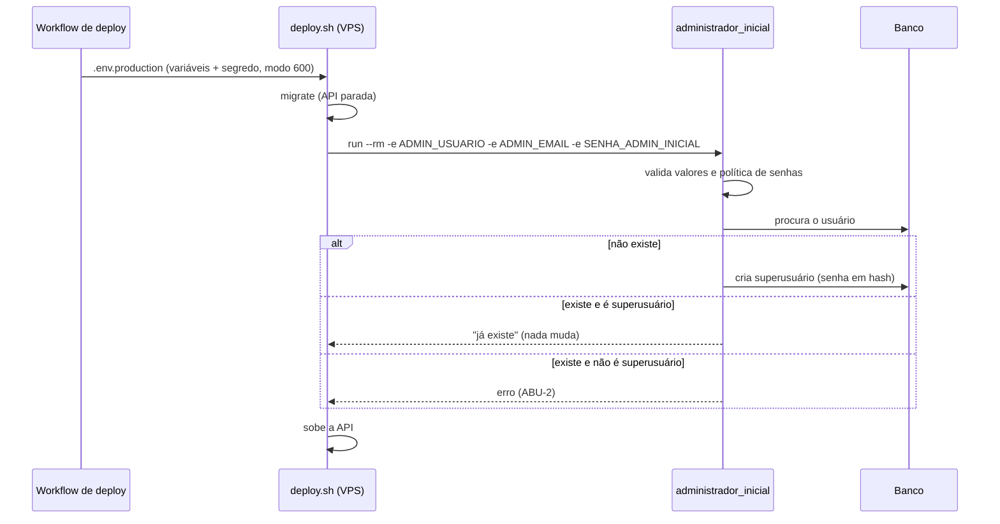

# Design — Administrador inicial criado pelo deploy

## 1. Visão geral
Um comando de gerenciamento próprio (`administrador_inicial`) roda dentro do `infra/deploy.sh`, depois das
migrações e antes de subir a API. Ele lê nome de usuário, e-mail e senha de variáveis de ambiente passadas só
àquela execução, valida a senha pela política de senhas do sistema e cria o superusuário se ele não existir.
Qualquer recusa encerra o comando com erro, o `set -e` interrompe o deploy e a API continua parada.

## 2. Reuso e impacto
| Existente (caminho) | Uso nesta mudança |
|---|---|
| `sistema-vinculus/backend/apps/acesso/management/commands/usuarios_padrao.py` e a chamada em `infra/deploy.sh` | modelo: senha passada por `-e` só ao comando, nunca ao serviço |
| `backend/config/settings/base.py` | recebe `AUTH_PASSWORD_VALIDATORS` (hoje vazio) |
| `infra/deploy.sh` | ganha o passo do administrador, entre `migrate` e a subida |
| `.github/workflows/deploy.yml` | a lista de segredos obrigatórios ganha `SENHA_ADMIN_INICIAL`; as variáveis `ADMIN_*` já são copiadas pelo `jq` das `vars` |
| `apps/common/` | recebe o service e o comando (a regra é da capacidade `base`) |

Capacidades de `specs/system/` afetadas: nenhuma ainda (a spec viva `base` nasce no arquivamento da 001).

## 3. Pesquisa
| Dúvida | Fonte (doc oficial da versão) | Conclusão |
|---|---|---|
| `createsuperuser --noinput` serve? | código do Django 5.2.18 instalado, `createsuperuser.py` | não: só valida a senha no modo interativo (linha 185); com `DJANGO_SUPERUSER_PASSWORD` ela entra sem validação; e falha se o usuário existe (linha 311), então não é idempotente |
| O projeto tem política de senhas? | `django/conf/global_settings.py` | não: `AUTH_PASSWORD_VALIDATORS = []` e `base.py` não define; é preciso configurar |
| `validate_password` aceita usuário para a regra de similaridade | `django.contrib.auth.password_validation` | sim: `validate_password(senha, user=Usuario(username=…, email=…))` |

## 4. Modelo de dados
Nenhuma tabela nova. Cria uma linha em `auth_user` (modelo padrão). Migração: nenhuma.

## 5. Contratos
Não há endpoint. A interface é de linha de comando e de ambiente.

| Interface | Entrada | Saída | Erros |
|---|---|---|---|
| `manage.py administrador_inicial` | variáveis `ADMIN_USUARIO`, `ADMIN_EMAIL`, `SENHA_ADMIN_INICIAL` (todas obrigatórias) | uma linha: `Administrador criado: <usuario>` ou `Administrador já existe: <usuario>`; código de saída 0 | código de saída 1 e mensagem sem a senha: variável ausente, vazia ou inválida; senha recusada pela política (lista os motivos); usuário existente que não é superusuário |
| `manage.py administrador_inicial --verificar` | as mesmas variáveis | `Configuração do administrador válida`; **não usa o banco** | os mesmos erros de validação (nunca o de usuário existente, que exige o banco) |

Valores no ambiente `production` do GitHub: variables `ADMIN_USUARIO` e `ADMIN_EMAIL`; secret `SENHA_ADMIN_INICIAL`.

## 6. Fluxos e estados de UI
Sem interface nova. O Admin (tela de login existente) passa a aceitar a conta criada.

## 7. Tratamento de erros
- Falha fechada: qualquer erro de validação levanta `CommandError`, sem criar nem alterar usuário. A validação (nome, e-mail e política de senhas) roda em toda execução, mesmo com a conta já criada: uma senha inicial que deixou de atender à política também recusa. Nome de usuário e e-mail passam pelos validadores do modelo e por `validate_email`.
- O deploy chama `--verificar` **antes** de `dc stop`: senha ausente, curta ou comum aborta com o Admin no ar (REQ-2.5). Só o que depende do banco (usuário comum com o mesmo nome) falha depois, com a API parada (REQ-2.4).
- Idempotência: a busca é por nome de usuário; se a criação perder a corrida (`IntegrityError`), o comando relê e trata como "já existe" se for superusuário.
- Nunca imprime a senha, nem em mensagem de erro: a lista de motivos da política não repete o valor.
- Deploy concorrente é impedido pelo `concurrency` do workflow.

## 8. Propriedades de corretude
- **PROP-1** Para qualquer número N ≥ 1 de execuções com os mesmos valores válidos, existe exatamente um usuário com aquele nome e a senha da primeira execução continua valendo. — valida: REQ-1.1, REQ-1.2
- **PROP-2** Para qualquer senha que a política de senhas recusa, nenhum usuário é criado e o comando termina com erro. — valida: REQ-2.2, REQ-2.1

## 9. Segurança (resumo — detalhe em threat-model.md)
Controles: CTL-1 recusa promover usuário comum; CTL-2 política de senhas e senha obrigatória; CTL-3 comando não escreve a senha; CTL-4 senha só no `run --rm`, fora do serviço da API; CTL-5 hash e `.env.production` com modo 600; CTL-6 limite de 5 tentativas de login por minuto por endereço, no Traefik (THR-6).

## 10. Estratégia de testes
Arquivo: `backend/apps/common/tests/test_administrador_inicial.py` (integração, banco real) e `backend/tests/test_pipeline.py` (leitura do script como texto).

| ID | Nível | Teste planejado |
|---|---|---|
| REQ-1.1 | integração | `test_req_1_1_cria_superusuario_quando_nao_existe` |
| REQ-1.2, PROP-1 | integração | `test_req_1_2_usuario_existente_nao_muda`, `test_req_1_2_nome_em_forma_unicode_nao_normalizada_acha_a_conta_existente`, `test_req_1_2_nome_que_so_difere_na_caixa_acha_o_superusuario`, `test_prop_1_repetir_a_execucao_nao_duplica_nem_troca_senha`, `test_prop_1_corrida_entre_duas_execucoes_superusuario_vira_ja_existe` |
| REQ-1.4 | integração | `test_req_1_4_superusuario_inativo_avisa_sem_alterar` |
| REQ-1.3 | integração | `test_req_1_3_conta_criada_entra_no_admin` (login pelo cliente de teste em `/admin/login/`) |
| REQ-2.1 | integração | `test_req_2_1_sem_senha_recusa_e_nao_cria` |
| REQ-2.2, PROP-2, CTL-2 | integração | `test_req_2_2_senha_fraca_recusa_e_nao_cria` (curta, 11 caracteres, só números, comum, com o motivo certo), `test_req_2_2_senha_parecida_com_o_usuario_recusa`, `test_req_2_2_senha_de_12_caracteres_forte_e_aceita` |
| REQ-2.3 | integração | `test_req_2_3_sem_usuario_ou_email_recusa`, `test_req_2_3_usuario_ou_email_invalido_recusa_com_mensagem_limpa` |
| REQ-2.4 | contrato do pipeline + `deploy.sh` executado com `docker` falso | `test_req_2_4_administrador_entre_migrate_e_subida`, `test_req_2_4_criacao_recusada_aborta_com_a_api_parada` |
| REQ-2.5, CTL-10 | integração + `deploy.sh` executado com `docker` falso | `test_req_2_5_verificar_valida_sem_tocar_no_banco`, `test_req_2_5_verificar_recusa_configuracao_ruim`, `test_req_2_5_conferencia_recusada_aborta_antes_de_parar_a_api`, `test_req_2_5_deploy_ok_chama_na_ordem_certa_e_a_senha_so_vai_pelo_ambiente`, `test_req_2_5_todo_run_do_deploy_sai_sem_rotulos_do_traefik`, `test_req_2_5_chamadas_do_administrador_sao_linhas_proprias_sem_or_true`, `test_ctl_10_todo_run_do_deploy_desliga_os_rotulos_do_traefik` |
| NFR-SEC-1, CTL-3, CTL-4 | integração + contrato do pipeline | `test_nfr_sec_1_senha_nao_aparece_na_saida`, `test_ctl_4_senha_nao_entra_no_compose_nem_no_servico_da_api` |
| NFR-SEC-1, CTL-8 | contrato do pipeline, com bash de verdade | `test_ctl_8_valor_devolve_a_senha_crua_com_cifrao_e_aspas`, `test_ctl_8_workflow_grava_com_aspas_simples_e_recusa_aspa_no_valor`; fora da suíte, o bloco real do workflow foi executado com `jq` e o `docker compose config` não imprimiu aviso |
| NFR-SEC-1, CTL-9 | contrato do pipeline | `test_ctl_9_variables_chegam_por_env_e_nao_dentro_do_texto_do_script`, `test_ctl_9_variable_com_nome_de_segredo_e_recusada`, `test_ctl_9_valor_usa_a_ultima_ocorrencia` |
| NFR-SEC-2, CTL-5 | integração | `test_nfr_sec_2_senha_gravada_so_como_hash`; `test_nfr_sec_2_producao_usa_hasher_forte_por_padrao` (os testes usam MD5, a produção não) |
| ABU-1 | integração | `test_abu_1_senha_nao_vai_para_saida_nem_para_log_no_sucesso`, `test_abu_1_senha_nao_vai_para_nenhuma_saida_nos_erros` (5 caminhos), `test_abu_1_senha_nao_vai_para_nenhuma_saida_quando_ha_usuario_comum`, `test_abu_1_verificar_nao_escreve_a_senha`; com `capsys` e `caplog` |
| ABU-2, CTL-1 | integração | `test_abu_2_usuario_comum_existente_nao_e_promovido`, `test_abu_2_corrida_entre_duas_execucoes_usuario_comum_nao_e_promovido` |
| ABU-3 | integração | `test_abu_3_senha_vazia_ou_so_espacos_recusa` |
| ABU-4 | contrato do compose (texto) + medição no ar | `test_abu_4_login_do_admin_tem_balde_de_5_fichas_por_minuto`; no ar, 2026-11-03: no domínio 5 `POST` passam e os seguintes recebem 429; o IP tem balde próprio |

O controle CTL-2 é coberto pelos testes de REQ-2.1, REQ-2.2 e ABU-3. O controle CTL-6 é coberto por `test_abu_4_login_do_admin_tem_balde_de_5_fichas_por_minuto` e pela medição no ar (de um único endereço de origem).

## 11. Observabilidade
O comando escreve uma linha de resultado no log do deploy e nada mais, sem a senha. O e-mail do administrador não é segredo: como variable do GitHub ele aparece no cabeçalho do passo "Generate .env.production" no Actions, visível a quem lê o repositório (risco aceito, ver threat-model.md). A senha é segredo e fica mascarada; o `.env.production` com aspas simples impede que o Compose imprima um pedaço dela.

## 12. Decisões
- **D-1** Comando próprio, não `createsuperuser` · alternativa: `createsuperuser --noinput` · motivo: não valida a senha e não é idempotente (ver seção 3) · consequência: um service pequeno com testes.
- **D-2** Política de senhas do sistema: similaridade com os dados do usuário, comprimento mínimo de **12**, senha comum e só números, via `AUTH_PASSWORD_VALIDATORS` · alternativa: padrão do Django (8) · motivo: o Admin fica exposto na internet · consequência: vale também para as senhas trocadas no Admin e para as contas da mudança de acesso. Confirmado pelo usuário em 2026-10-28.
- **D-3** Senha passada por `docker compose run -e` só àquela execução, como o Vinculus · alternativa: variável no serviço da API · motivo: a senha não fica visível no contêiner em execução · consequência: o compose de produção não cita `SENHA_ADMIN_INICIAL`. Enquanto o `run` dura (segundos) a senha fica visível em `docker inspect` do contêiner avulso: risco aceito pendente de ratificação (threat-model.md).
- **D-4** Nome e e-mail em variables do GitHub, senha em secret · motivo: só a senha é segredo; os outros dois aparecem no Admin de qualquer forma · consequência: o `jq` do workflow já os copia para o `.env.production`.
- **D-6** Limite de tentativas no Traefik, por rótulos do nosso compose (`ratelimit`: média 5, período 1 minuto, rajada 5), num roteador próprio que casa só `POST` em `/entrelinhas/admin/login/` · alternativas: django-axes (dependência nova, exige ADR), limitar todo o Admin (os estáticos estourariam o limite) · motivo: sem dependência e só atinge a tentativa de senha · consequência: é um **balde de fichas**: 5 seguidas e depois 1 a cada ~12 s, por roteador. O domínio e o IP têm baldes separados (medido no ar em 2026-11-03), então o limite efetivo é de até 10 seguidas; risco aceito (ver threat-model.md).
- **D-7** `--verificar` antes de parar a API (auditoria M3) · alternativa: validar só tamanho no workflow · motivo: a política inteira (comum, só números, parecida) também deve abortar com o Admin no ar · consequência: o REQ-2.4 vale só para o que depende do banco; nasce o REQ-2.5. Decisão do agente, por delegação do dono (2026-11-03).
- **D-8** `.env.production` com aspas simples e `valor()` que tira as aspas (auditoria A1) · alternativas: recusar `$` na senha, ou guardar a senha em arquivo próprio · motivo: cobre também `DJANGO_SECRET_KEY` e `POSTGRES_PASSWORD`, e aceita qualquer caractere exceto aspa simples e quebra de linha · consequência: provado com o bloco real do workflow e o Compose, sem aviso. Decisão do agente, por delegação do dono.
- **D-9** A senha inicial continua obrigatória em todo deploy, mesmo com a conta criada (auditoria B4) · motivo: deploy determinístico e validação contínua da senha guardada · consequência: o segredo não pode ser apagado; o dono pode trocar a senha no Admin. Decisão do agente, por delegação do dono.
- **D-5** O comando fica em `apps/common` · motivo: pertence à capacidade `base`; não há app de domínio de acesso ainda · consequência: a mudança de acesso e espaço pode movê-lo.

## 13. Portões da constituição
| Portão | ✔/✘ | Justificativa |
|---|---|---|
| Simplicidade | ✔ | um comando, um service, uma setting |
| Anti-abstração | ✔ | usa `validate_password` e `create_superuser` do Django |
| Teste primeiro | ✔ | testes escritos e vistos falhando antes do service (tarefas da onda 2) |
| Integração real | ✔ | banco real; nada mockado |
| Segurança | ✔ | threat-model.md com 9 ameaças e 9 controles (CTL-1 a 6 e 8 a 10) |
| Reuso | ✔ | modelo do Vinculus (`usuarios_padrao` e a chamada em `deploy.sh`) |
| Validação no backend (Art. 6) | ✔ | toda a validação é do comando; não há front |

## 14. Rastreamento de complexidade
Nenhuma exceção.

## 15. Riscos e rollback
- **Transição para o `.env.production` com aspas simples (onda 5):** até a 001 o arquivo era sem aspas e o Compose
  interpolava `$` e cortava ` #`. Se o `POSTGRES_PASSWORD` real tem `$` ou ` #`, o Postgres guardou a senha
  "mastigada" e as aspas passariam o valor cru: a API deixaria de autenticar. Por isso o workflow **recusa** essa senha
  antes de tocar na VPS. Se isso acontecer, troque a senha do banco por uma sem esses caracteres (e aplique-a no
  Postgres) antes de publicar. `DJANGO_SECRET_KEY` com `$` só invalida as sessões.
- Configuração recusada na conferência (`--verificar`): o Admin continua no ar; corrija os valores no GitHub e rode o workflow de novo.
- Recusa que só aparece depois de parar a API (usuário comum com o mesmo nome, banco): a API fica parada até o próximo
  deploy. O backup anterior permanece em `~/backups/project-entrelinhas`.
- Rollback: remover a chamada em `deploy.sh`; a conta criada permanece até ser apagada no Admin.
- Senha esquecida: a conta existente nunca muda por este comando (REQ-1.2); troque a senha pelo Admin ou por
  `manage.py changepassword` na VPS.
