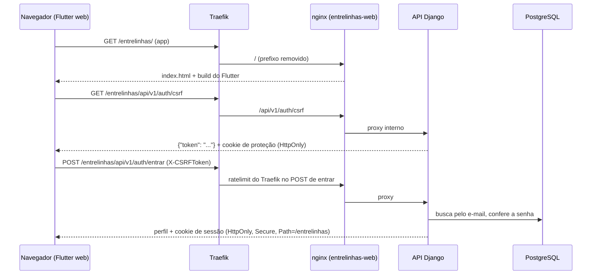

# Design — Contas, perfil, grupo de escrita, convite e casca do front

## 1. Visão geral
O navegador fala com **uma origem só**: `https://jpsys.duckdns.org/entrelinhas`. O Traefik tira o prefixo e entrega tudo a um
contêiner **nginx** (`entrelinhas-web`) que serve o app Flutter e repassa `/api/` ao Django pela rede interna (padrão do
`analista-b3`). A API não ganha rota pública própria no Traefik; o Admin continua com as rotas diretas da mudança 002.
A sessão é o cookie de sessão do Django (ADR-0004 da 001), sem token em `localStorage`.

## 2. Reuso e impacto
| Existente (caminho) | Uso nesta mudança |
|---|---|
| `analista-b3/frontend/` e `analista-b3/infra/` | padrão do front: Flutter por feature, SDK em contêiner com SHA-256, nginx de uma origem só, `go_router`, `dio`, `flutter_riverpod` |
| `analista-b3/compose.deploy.yml` | rótulos do Traefik do serviço web: `stripprefix`, redirecionamento da barra final, rotas do domínio e do IP |
| `backend/apps/common/` (002) | `services.py` e o comando de administrador não mudam; a política de senhas de 12 caracteres é reaproveitada |
| `docker-compose.deploy.yml` (002) | ganha o serviço `entrelinhas-web`; os roteadores do Admin e do login do Admin ficam como estão |
| `infra/deploy.sh` e `.github/workflows/` | constroem a imagem do SDK, o web e rodam `flutter analyze` e `flutter test` no CI |

Capacidades de `specs/system/` afetadas: nenhuma ainda (a spec viva `acesso-espaco` nasce ao arquivar).

## 3. Pesquisa
| Dúvida | Fonte | Conclusão |
|---|---|---|
| Como o DRF trata CSRF em rota anônima? | `rest_framework/authentication.py`, `SessionAuthentication` | só aplica CSRF a quem já está autenticado; e `APIView` é `csrf_exempt`. Rota pública de login ficaria sem CSRF (login CSRF). É preciso uma classe própria que sempre exige o token |
| O cookie de CSRF precisa ser legível pelo script? | docs do Django, CSRF | não, se o token for entregue no corpo de uma resposta (`get_token`) e enviado no cabeçalho `X-CSRFToken`; o cookie com o segredo pode ficar `HttpOnly` |
| O navegador manda o cookie sem `withCredentials` na mesma origem? | comportamento padrão do XHR/fetch | sim: mesma origem envia cookies por padrão |
| Flutter web com rota por fragmento | `go_router`, estratégia de URL padrão (hash) | `https://…/entrelinhas/#/convite/<código>`: o fragmento nunca vai ao servidor nem a logs |
| Versões do Flutter e dos pacotes | `analista-b3/frontend/Dockerfile` e `pubspec.lock` (já usados e conferidos pelo dono) | Flutter 3.47.8 com SHA-256 publicado; `dio ^5.11.1`, `flutter_riverpod ^3.4.3`, `go_router ^18.1.1`; as versões exatas ficam no `pubspec.lock` gerado no build |

## 4. Modelo de dados
App novo `backend/apps/acesso/`. O usuário é o `auth.User` padrão (decisão da 002).

| Entidade | Campo | Tipo | Restrições | Observação |
|---|---|---|---|---|
| `Grupo` | `id` | UUID | PK | |
| | `tipo` | texto | enum (`escrita`) | grupos de estudo e leitura entram depois |
| | `limite_membros` | inteiro pequeno | 1 a 2 hoje, padrão 2 | o limite é dado do grupo (Art. 13) |
| | `criado_em` | data e hora | | |
| `Perfil` | `usuario` | 1 para 1 com `auth.User` | PK | |
| | `nome` | texto (60) | não vazio, sem caracteres de controle | |
| | `cor` | texto (7) | `#RRGGBB` em maiúsculas | |
| | `grupo` | FK `Grupo` | pode ser nulo; `PROTECT` | uma pessoa, um grupo |
| `Convite` | `id` | UUID | PK | |
| | `grupo` | FK `Grupo` | | |
| | `criado_por` | FK `Perfil` | | |
| | `codigo_hash` | texto (64) | único | SHA-256 do código; o código nunca é guardado |
| | `expira_em` | data e hora | | criação + 7 dias |
| | `usado_em`, `invalidado_em` | data e hora | podem ser nulos | |

Restrições no banco:
- índice único parcial em `Convite(grupo)` onde `usado_em` e `invalidado_em` são nulos: **no máximo um convite pendente por grupo**.
- índice único em `lower(auth_user.email)` (onde o e-mail não é vazio): **um e-mail, uma conta**, criado por `RunSQL` reversível.
- `CHECK` de `cor` com expressão regular e de `limite_membros` entre 1 e 2.

Migração: três tabelas novas e um índice; reversível; sem dados a preservar. A conta do administrador não tem `Perfil`
(o REQ-4.9 trata isso).

## 5. Contratos
Fonte formal: `contracts/openapi.yaml`. Prefixo público `/entrelinhas/api/v1`; o servidor vê `/api/v1`.

| Operação | Auth | Permissão | Entrada | Saída | Erros | Limites |
|---|---|---|---|---|---|---|
| `GET /auth/csrf` | nenhuma | pública | — | `{"token"}` e cookie de proteção | — | |
| `POST /auth/entrar` | nenhuma + CSRF | pública | `email`, `senha` | `200` perfil | `400` mensagem única; `403` CSRF; `429` do Traefik | balde de 5 fichas por minuto por origem (Traefik) |
| `POST /auth/sair` | sessão + CSRF | participante | — | `204` | `401`, `403` | |
| `GET /perfil` | sessão | participante | — | `200` `{nome, email, cor, completo, grupo}` | `401` | |
| `PATCH /perfil` | sessão + CSRF | participante | `nome`, `cor` | `200` perfil | `401`, `403`, `422` | |
| `POST /perfil/senha` | sessão + CSRF | participante | `senha_atual`, `senha_nova` | `204` | `401`, `403`, `422` | |
| `POST /grupo` | sessão + CSRF | participante com perfil completo e sem grupo | — | `201` grupo | `401`, `403`, `409` (já tem grupo), `422` (perfil incompleto) | |
| `GET /grupo` | sessão | participante | — | `200` `{grupo: {…, membros:[{nome, cor}], vaga}}` ou `{grupo: null}` | `401` | |
| `POST /grupo/convites` | sessão + CSRF | membro de grupo com vaga | — | `201` `{codigo, expira_em}` | `401`, `403`, `409` (sem vaga ou sem grupo) | |
| `POST /convites/aceitar` | nenhuma + CSRF | pública | `codigo`, `nome`, `email`, `senha`, `cor` | `201` perfil, já com sessão | `400` mensagem única; `403` CSRF; `422` (cor, senha, nome) | mesma regra de balde por origem |

O `codigo` aparece **uma única vez**, na resposta que gera o convite. O app monta o link
`<origem>/entrelinhas/#/convite/<codigo>`. Recurso de outro grupo responde `404`.

## 6. Fluxos e estados de UI
| Tela | Vazio | Carregando | Erro | Sucesso | Sem permissão | Offline |
|---|---|---|---|---|---|---|
| Entrar | formulário | botão com indicador | mensagem única em português | vai para o perfil ou o grupo | — | aviso "sem conexão" |
| Criar conta (convite) | formulário com nome, e-mail, senha, cor | indicador | mensagem única; erros por campo (cor, senha) | vai ao grupo | — | aviso |
| Perfil | nome e cor em branco quando incompleto | indicador | erros por campo | mostra o perfil salvo | redireciona para entrar | aviso |
| Grupo | "você ainda não tem grupo" com botão criar | indicador | mensagem | membros com nome e cor; botão convidar se houver vaga | redireciona para entrar | aviso |
| Convidar | — | indicador | "grupo cheio" | link para copiar, com a validade | — | aviso |

Perfil incompleto leva sempre ao perfil primeiro (REQ-5.5). Acessibilidade e responsividade: NFR-A11Y-1 e NFR-RESP-1.

## 7. Tratamento de erros
- Falha fechada: dúvida de autenticação vira `401` ou a mensagem única de `400`, nunca detalhe.
- Entrar e aceitar convite devolvem a **mesma** resposta para e-mail inexistente, senha errada, convite inválido e e-mail já usado.
  O tempo também é parecido: quando o e-mail não existe roda-se uma verificação de senha de mentira (como o `ModelBackend`).
- Escrita que muda várias tabelas (aceitar convite) roda numa transação com `select_for_update` no grupo e no convite.
- O app traduz códigos em mensagens em português; nada de rastro técnico na tela.

## 8. Propriedades de corretude
- **PROP-1** Para qualquer cor `#RRGGBB`, o sistema a aceita se e somente se o contraste com o fundo claro e com o escuro for ao menos 3 para 1. — valida: REQ-4.3, REQ-4.4
- **PROP-2** Para qualquer sequência de convites e aceites, inclusive simultâneos, um grupo nunca tem mais membros que `limite_membros`. — valida: REQ-2.3, REQ-3.7
- **PROP-3** Para qualquer convite, o código só é aceito uma vez, e o texto do código nunca é gravado nem devolvido por outra rota. — valida: REQ-3.4, REQ-3.5, NFR-SEC-2
- **PROP-4** Para qualquer e-mail, existente ou não, `entrar` e `aceitar` devolvem o mesmo status e o mesmo corpo de falha. — valida: REQ-1.2, REQ-3.5, REQ-3.6, ABU-2

## 9. Segurança (resumo — detalhe em threat-model.md)
Controles: CTL-11 balde de login no Traefik; CTL-12 respostas e tempo iguais; CTL-13 convite forte, em hash, de uso único e no
fragmento da URL; CTL-14 trava do grupo na entrada; CTL-15 CSRF obrigatório até em rota anônima; CTL-16 cookies `HttpOnly`,
`Secure`, `SameSite` e com nome e caminho próprios; CTL-17 acesso cruzado devolve 404; CTL-18 permissão padrão negada e lista de
rotas públicas; CTL-19 CSP do nginx e Flutter sem CDN; CTL-20 SDK por SHA-256, `pubspec.lock` e pacotes do ADR.

## 10. Estratégia de testes
Back em `backend/apps/acesso/tests/` e `backend/tests/`; front em `frontend/test/`. Os docstrings levam `[003]`.

| ID | Nível | Teste planejado |
|---|---|---|
| REQ-1.1, REQ-1.2, PROP-4 | integração | `test_req_1_1_entrar_cria_sessao`, `test_req_1_2_entrar_falha_igual_para_senha_errada_e_email_inexistente` |
| REQ-1.3 | integração | `test_req_1_3_sair_encerra_a_sessao_no_servidor` |
| REQ-1.4 | integração | `test_req_1_4_rotas_protegidas_respondem_401_sem_sessao`, `test_req_1_4_endpoint_csrf_e_publico_e_devolve_token_e_cookie`, e a lista fechada de rotas públicas em `tests/test_rotas_publicas.py` (com a lista de rotas públicas) |
| REQ-2.1, REQ-2.2, REQ-2.4 | integração | `test_req_2_1_cria_grupo`, `test_req_2_2_segundo_grupo_recusado`, `test_req_2_4_perfil_incompleto_nao_cria_grupo` |
| REQ-2.3, REQ-3.7, PROP-2 | integração com concorrência real | `test_prop_2_dois_aceites_simultaneos_no_ultimo_lugar_deixam_um_so`, `test_req_3_7_grupo_cheio_recusa_convite` |
| REQ-3.1, REQ-3.2, REQ-3.3 | integração | `test_req_3_1_gera_convite`, `test_req_3_2_novo_convite_invalida_o_anterior`, `test_req_3_3_convite_vale_7_dias`, `test_req_3_3_convite_expirado_e_recusado` |
| REQ-3.4 a REQ-3.6, PROP-3 | integração | `test_req_3_4_aceitar_cria_conta_perfil_e_entrada`, `test_req_3_5_convite_usado_expirado_ou_inexistente_respondem_igual`, `test_req_3_6_email_ja_usado_responde_igual`, `test_prop_3_codigo_so_uma_vez_e_nunca_gravado` |
| REQ-4.1 a REQ-4.3, REQ-4.9 | integração | `test_req_4_1_perfil`, `test_req_4_2_define_nome_e_cor_da_conta_sem_perfil`, `test_req_4_2_altera_so_o_nome`, `test_req_4_3_cor_fora_do_formato_recusada`, `test_req_4_9_perfil_incompleto_da_conta_do_administrador` |
| REQ-4.4, REQ-4.5, PROP-1 | unidade + integração | `test_prop_1_contraste_minimo_3_para_1_nos_dois_temas` (várias cores, inclusive limites), `test_req_4_5_cor_igual_ou_indistinguivel_recusada` |
| REQ-4.6, REQ-4.7 | integração | `test_req_4_6_troca_senha_encerra_as_outras_sessoes`, `test_req_4_7_senha_atual_errada_ou_nova_fraca_recusadas` |
| REQ-4.8 | integração | `test_req_4_8_grupo_mostra_nome_e_cor_do_parceiro_e_nunca_o_email` |
| ABU-1 | contrato do compose (texto) + medição no ar | `test_abu_1_entrar_tem_balde_de_5_fichas_por_minuto` |
| ABU-2 | integração | `test_abu_2_entrar_nao_revela_se_o_email_existe`, `test_abu_2_aceitar_nao_revela_se_o_email_existe` |
| ABU-3 | integração | `test_abu_3_codigo_adivinhado_ou_reutilizado_recusado_sem_revelar` |
| ABU-4, NFR-SEC-1 | integração | `test_abu_4_post_sem_token_de_protecao_e_recusado_ate_em_rota_anonima`, `test_nfr_sec_1_cookies_httponly_samesite_com_nome_proprio`, `test_nfr_sec_1_producao_cookies_seguros_e_no_caminho_do_prefixo` |
| NFR-SEC-2 | integração | `test_nfr_sec_2_codigo_do_convite_tem_128_bits_e_so_o_hash_e_gravado` |
| NFR-SEC-3 | integração | cada regra de validação tem um teste de API que prova o 422 |
| Isolamento | integração | `test_req_isolamento_cada_participante_so_enxerga_o_proprio_grupo` (as rotas não recebem identificador de grupo, então não há 404 a provar) |
| REQ-5.1 a REQ-5.5, NFR-A11Y-1, NFR-RESP-1 | widget e e2e (Flutter) | `entrar_test`, `convite_test`, `perfil_test`, `grupo_test`; e2e no contêiner com navegador, em 360 e 1280 px, claro e escuro |
| CTL-11, CTL-16, CTL-19 | contrato do compose e do nginx (texto) + `docker compose config` | `test_ctl_11_*`, `test_ctl_16_*`, `test_ctl_19_*` |
| Cadeia de suprimentos (CTL-20) | verificação do build | `flutter pub get` com `pubspec.lock` versionado; SHA-256 do SDK conferido no `Dockerfile` |

## 11. Observabilidade
Logs do nginx sem corpo de requisição e sem o fragmento da URL (que o navegador nem envia). Logs do Django sem senha, sem código de
convite e sem e-mail em mensagens de erro. Eventos sensíveis (convite gerado, convite aceito, senha trocada, login falho) registrados
com data e IP de origem, sem dado pessoal além do identificador interno.

## 12. Decisões
- **D-1** Uma origem só, com nginx na frente do app e da API · alternativas: API pública direta no Traefik; origens separadas com CORS · motivo: sem CORS, o cookie é de primeira parte, e a API continua fora do Traefik · consequência: um contêiner a mais; o Admin segue pelas rotas diretas da 002.
- **D-2** Sessão do Django, token de CSRF entregue por `GET /auth/csrf` no corpo, cookie de proteção `HttpOnly` · alternativa: cookie de CSRF legível pelo script · motivo: o script do navegador não lê nenhum cookie · consequência: o app guarda o token em memória e o pede de novo ao recarregar.
- **D-3** Classe de autenticação própria que **sempre** exige CSRF, inclusive para anônimo · motivo: DRF só exige CSRF de quem está autenticado (seção 3) · consequência: login e aceite de convite têm CSRF.
- **D-4** Login por e-mail via `authenticate(email=…)` com um backend próprio, mantendo o `ModelBackend` do Admin · alternativa: trocar o campo de login do modelo · motivo: o modelo de usuário padrão não muda (decisão da 002) · consequência: índice único em `lower(email)`.
- **D-5** Convite no **fragmento** da URL e código só no corpo do `POST` · alternativa: código no caminho ou na consulta · motivo: o fragmento não vai ao servidor, ao Traefik, ao nginx nem ao cabeçalho `Referer` · consequência: a tela de convite não valida o código antes do envio.
- **D-6** Limite de login no **Traefik**, como na 002 (balde de 5 fichas), sem biblioteca nem cache compartilhado · alternativa: limitador do DRF · motivo: os 3 processos do gunicorn não compartilham memória · consequência: vale por origem e por roteador, e não contém ataque vindo de muitos IPs.
- **D-7** Cor: aceita se contraste mínimo de 3 para 1 com `#FFFFFF` e `#121212` e diferença de cor (CIE76 no espaço Lab) de pelo menos 25 em relação à da outra pessoa do grupo · motivo: dá um critério testável para "ilegível" e "indistinguível" · consequência: o limite de 25 é calibrável e fica numa constante.
- **D-8** Pacotes do Flutter: `dio`, `flutter_riverpod`, `go_router` e, só em teste, `flutter_lints` e `mocktail`, sem geração de código · alternativa: `freezed` e geradores como no `analista-b3` · motivo: o escopo é pequeno e geradores aumentam o build e a superfície · consequência: classes escritas à mão (ADR-0005).
- **D-9** `frontend/` por feature (`app`, `features/acesso`, `features/perfil`, `features/grupo`, `shared/api`, `shared/ui`), como no `analista-b3`.

## 13. Portões da constituição
| Portão | ✔/✘ | Justificativa |
|---|---|---|
| Simplicidade | ✔ | 2 projetos implantáveis (API e web), 3 tabelas, sem fila nem e-mail |
| Anti-abstração | ✔ | Django e DRF diretos; `dio` e `go_router` sem camada própria além do cliente da API |
| Teste primeiro | ✔ | tarefas de teste vêm antes das de implementação |
| Integração real | ✔ | PostgreSQL real, inclusive concorrência real com threads |
| Segurança | ✔ | threat-model.md com 10 ameaças e 10 controles |
| Reuso | ✔ | padrão do `analista-b3` para o front e o nginx; `ModelBackend` e a política de senhas existentes |
| Art. 6 (validação no backend) | ✔ | toda regra tem 422 de API; o app só repete para avisar |
| Art. 11 (dependências) | ✔ | ADR-0005 lista cada pacote |
| Art. 13 (grupo de até 2) | ✔ | `limite_membros` no grupo e trava na entrada |

## 14. Rastreamento de complexidade
| Exceção | Por que é necessária | Alternativa simples rejeitada |
|---|---|---|
| Contêiner nginx além da API | Flutter web é estático e a mesma origem evita CORS | servir o build pelo próprio Django: mistura estático do app com a API e perde o CSP do nginx |
| Classe de autenticação própria para CSRF | o DRF não exige CSRF de anônimo | confiar só em `SameSite`: não cobre navegador antigo nem subdomínio |

## 15. Riscos e rollback
- A primeira publicação do front baixa o SDK do Flutter (cerca de 1 GB) e compila: o primeiro deploy é lento (minutos). O SDK fica em cache de camada.
- O CSP do nginx precisa de `wasm-unsafe-eval` para o motor do Flutter; é a única exceção e está no ADR-0005.
- O índice único em `lower(email)` falha se já houver e-mails repetidos: hoje só existe a conta do administrador.
- Rollback: reverter o commit remove o serviço web; a migração é reversível; as rotas diretas do Admin (002) não mudam, então o Admin continua acessível.
- A criação do dono depende da conta do administrador ter o e-mail certo em `ADMIN_EMAIL` (é o login do app).
