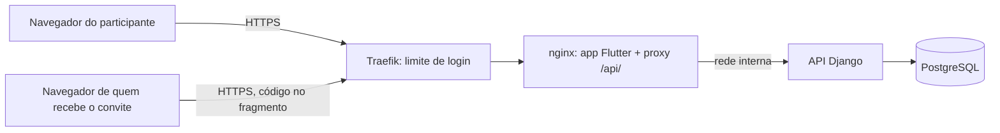

# Modelo de ameaças — Contas, perfil, grupo, convite e front

## Ativos e dados
| Ativo | Classificação | Por que importa |
|---|---|---|
| Senhas dos participantes (em hash) | segredo | a conta dá acesso ao texto íntimo das próximas mudanças |
| Sessão (cookie) | segredo | quem a tem age como o participante |
| Código do convite | segredo de curta duração | entrega a vaga no grupo e cria uma conta |
| E-mail, nome e cor | pessoal (LGPD) | identificam a pessoa; o e-mail não pode ir à outra pessoa do grupo |
| Pertencimento ao grupo | interno | decide quem lê o quê nas próximas mudanças |
| Conta do administrador (dono) | segredo | é a conta do dono no app e tem acesso total ao Admin e ao banco |

## Fronteiras de confiança e fluxo de dados

## Ameaças (STRIDE por fluxo)
| ID | Fluxo | STRIDE | Ameaça | Prob. | Impacto | Risco | Controle(s) |
|---|---|---|---|---|---|---|---|
| THR-11 | Internet → entrar | S | força bruta de senha | M | A | A | CTL-11 |
| THR-12 | entrar e aceitar convite | I | descobrir quais e-mails têm conta, pela resposta ou pelo tempo | M | M | M | CTL-12 |
| THR-13 | convite | S | adivinhar ou reutilizar o código | B | A | M | CTL-13 |
| THR-14 | aceitar e convidar | E | um terceiro entra em grupo cheio por corrida entre dois aceites | B | A | M | CTL-14 |
| THR-15 | navegador → API | T | CSRF, inclusive "login CSRF" que põe a vítima na conta do atacante | M | M | M | CTL-15 |
| THR-16 | sessão | S | roubo ou vazamento da sessão (script injetado; cookie lido por outro app do mesmo domínio) | M | A | A | CTL-16 |
| THR-17 | API | I | participante lê grupo ou convite de outro grupo | B | A | M | CTL-17 |
| THR-18 | API agora alcançável pela internet | E | rota nova esquecida sem login | M | A | A | CTL-18 |
| THR-19 | front | T | script ou recurso externo injetado no app | B | A | M | CTL-19 |
| THR-20 | build | T | SDK ou pacote adulterado | B | A | M | CTL-20 |

## Controles
| ID | Controle | Atende | Teste/evidência |
|---|---|---|---|
| CTL-11 | roteador próprio no Traefik para `POST` de entrar e de aceitar convite, com balde de 5 fichas por minuto por origem; senha com política de 12 caracteres | THR-11, ABU-1 | `test_abu_1_entrar_tem_balde_de_5_fichas_por_minuto`; medição no ar |
| CTL-12 | mesma resposta e verificação de senha fictícia quando o e-mail não existe | THR-12, ABU-2, REQ-1.2, REQ-3.6 | `test_abu_2_*`, `test_req_1_2_*` |
| CTL-13 | código com 256 bits (`token_urlsafe(32)`), guardado só em SHA-256, uso único e atômico, validade de 7 dias, resposta única para os casos inválidos, código no fragmento da URL | THR-13, ABU-3, NFR-SEC-2, REQ-3.5 | `test_prop_3_*`, `test_nfr_sec_2_*`, `test_abu_3_*` |
| CTL-14 | trava (`select_for_update`) no grupo e contagem dentro da transação; limite como dado do grupo | THR-14, REQ-2.3, REQ-3.7 | `test_prop_2_dois_aceites_simultaneos_*` (threads reais) |
| CTL-15 | classe de autenticação que sempre exige o token de CSRF, inclusive para anônimo | THR-15, ABU-4 | `test_abu_4_*` |
| CTL-16 | cookies `entrelinhas_sessionid` e `entrelinhas_csrftoken` com `HttpOnly`, `Secure`, `SameSite=Lax` e `Path=/entrelinhas`; sessão renovada ao entrar; troca de senha encerra as outras sessões | THR-16, NFR-SEC-1, REQ-4.6 | `test_nfr_sec_1_*`, `test_req_4_6_*` |
| CTL-17 | toda consulta filtrada pelo grupo da pessoa; o que é de outro grupo responde 404 | THR-17 | `test_req_isolamento_*` |
| CTL-18 | permissão padrão `IsAuthenticated` e lista fechada de rotas públicas (token de proteção, entrar, aceitar), verificada por teste | THR-18, REQ-1.4 | `test_req_1_4_*` |
| CTL-19 | nginx com CSP restritivo (`default-src 'self'`, `frame-ancestors 'none'`), `nosniff`, `Referrer-Policy` e Flutter compilado sem CDN | THR-19 | `test_ctl_19_*` (texto do nginx) |
| CTL-20 | SDK baixado e conferido por SHA-256; `pubspec.lock` versionado; só os pacotes do ADR-0005 | THR-20 | verificação do build; revisão do `pubspec.yaml` |

## OWASP Top 10:2025 — percorrido
| Cat. | Aplica? | Como foi tratado |
|---|---|---|
| A01 Controle de acesso / SSRF | sim | CTL-17, CTL-18; sem requisição de saída |
| A02 Configuração | sim | CTL-16, CTL-19; `check --deploy` continua bloqueante; nginx sem versão (`server_tokens off`) |
| A03 Cadeia de suprimentos | sim | CTL-20; pacotes do front listados e versionados |
| A04 Criptografia | sim | hash de senha do Django; hash do convite; TLS pelo Traefik |
| A05 Injeção | sim | ORM; nome com limite e sem caracteres de controle; o app mostra texto, nunca HTML |
| A06 Design inseguro | sim | CTL-12, CTL-14; convite fora do caminho da URL |
| A07 Autenticação | sim | CTL-11, CTL-12, CTL-16; sem MFA (fora de escopo) |
| A08 Integridade | sim | CTL-20; imagem construída no deploy a partir do commit aprovado |
| A09 Log e alerta | parcial | eventos sensíveis registrados sem dado pessoal; sem alerta externo (fora de escopo) |
| A10 Condições excepcionais | sim | falha fechada; transação em tudo que muda mais de uma tabela |

## Dependências novas
| Pacote | Versão | Verificado no registro? | Motivo |
|---|---|---|---|
| Flutter SDK | 3.47.8 (SHA-256 do `Dockerfile`) | sim: valor já usado e conferido no `analista-b3`; o hash é conferido de novo no build | front |
| `dio` | ^5.11.1 | a confirmar no `flutter pub get` da implementação (já usado no `analista-b3`) | cliente HTTP |
| `flutter_riverpod` | ^3.4.3 | idem | estado |
| `go_router` | ^18.1.1 | idem | rotas, inclusive por fragmento |
| `flutter_lints` | ^6.0.0 | idem | análise estática (dev) |
| `mocktail` | ^1.0.5 | idem | testes (dev) |
| imagem `nginx:1.29-alpine` | 1.29 | sim: imagem oficial já usada no `analista-b3` | servir o build e repassar `/api/` |

## Riscos aceitos (somente pelo humano)
| Ameaça | Motivo | Quem aceitou | Data |
|---|---|---|---|
| O administrador da plataforma é uma das duas pessoas e lê o banco e o Admin; "privado" não vale contra ele nas próximas mudanças, salvo decisão futura por criptografia por usuário | o produto é de uso pessoal entre duas pessoas e o operador é uma delas; a decisão volta no módulo `registros` | usuário | 2026-11-03 |
| O limite de login protege contra uma origem; ataque vindo de muitos IPs não é contido | com senha de 12 caracteres e política, o risco restante é indisponibilidade do login | usuário | 2026-11-03 |
| O CSP do app precisa de `wasm-unsafe-eval` por causa do motor do Flutter | exigência do Flutter web; o resto do CSP é restritivo | usuário | 2026-11-03 |

Os três riscos acima foram propostos pelo agente no G2 e aceitos pelo usuário em 2026-11-03 ("Aprovo e aceito").
