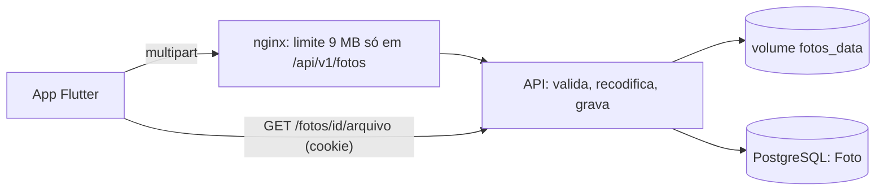

# Design — Fotos privadas (manuscrito e perfil)

## 1. Visão geral
Novo app Django `fotos` (fica ao lado de `acesso`), sem serviço novo no compose: a API grava num volume `fotos_data` montado em
`/data/fotos` e serve o arquivo por uma view autenticada (nunca por URL pública). O app Flutter ganha a foto de perfil.

## 2. Reuso e impacto
- `acesso.Perfil` ganha `foto` (FK opcional para `Foto`, `SET_NULL`); `GET /grupo` e `GET /perfil` passam a devolver `foto_url`.
- `docker-compose.deploy.yml`: volume `fotos_data` (API e backup), variável `FOTOS_DIR`. `deploy.sh`: backup do volume junto do banco e `limpar_fotos`.
- nginx: `client_max_body_size 9m` só em `location = /api/v1/fotos` (o resto continua em 1 MB).
- Reuso do `SessaoComCsrf`, do 404 por grupo e do formato de erro `{"campos":…}`/`{"detalhe":…}` da 003.

## 3. Pesquisa
- Django `ImageField` valida com Pillow, mas só abre o arquivo; a defesa aqui é **decodificar e regravar** (`Image.open` → `verify` → recarregar → `save`), que descarta metadados e trailers.
- Pillow: limitar `Image.MAX_IMAGE_PIXELS` (proteção contra bomba de descompressão) e checar o tamanho **antes** de decodificar.
- Servir imagem com `Content-Type` fixado pelo servidor (o tipo da imagem recodificada), nunca o enviado.
- Navegador: ``/`Image.network` na mesma origem envia o cookie de sessão; precisa de teste real no navegador (T-3.3).

## 4. Modelo de dados
| Modelo | Campos |
|---|---|
| `Foto` | `id` UUID PK · `dono` FK usuário · `grupo` FK grupo (nulo se a pessoa ainda não tem grupo; preenchido com o grupo do dono) · `finalidade` (`manuscrito`/`perfil`) · `tipo` (`image/jpeg`…) · `largura`, `altura`, `bytes` · `arquivo` (caminho relativo, UUID) · `anexada` bool · `criada_em` |
| `Perfil.foto` | FK nula para `Foto` (`SET_NULL`), finalidade `perfil` |
A 005 acrescenta `Foto.registro` (FK nula). Índices: `(dono, criada_em)` para a cota; `(anexada, criada_em)` para a limpeza.

## 5. Contratos
`contracts/openapi.yaml` (OpenAPI 3.1). Rotas de `/api/v1`:
| Método e rota | O que faz |
|---|---|
| `POST /fotos` (multipart: `arquivo`, `finalidade`) | valida, recodifica, grava; 201 `{id, finalidade, largura, altura}` |
| `GET /fotos/{id}/arquivo` | imagem; 404 se a pessoa não pode ver |
| `DELETE /fotos/{id}` | só foto avulsa do próprio dono; 204 |
| `PUT /perfil/foto` `{foto_id}` | define a foto de perfil; 200 perfil |
| `DELETE /perfil/foto` | remove; 204 |
Erros: 422 `{"campos":{"arquivo":[…]}}`, 404 `{"detalhe":…}`, 409 (apagar anexada), 429 (cota).

## 6. Fluxos e estados de UI
Perfil: sem foto → inicial sobre a cor; "Escolher foto" abre o seletor; prévia circular; "Enviar" mostra carregando e depois a foto; "Remover foto".
Erros de arquivo aparecem sob o botão, em português.

## 7. Tratamento de erros
| Situação | Resposta |
|---|---|
| Arquivo não é imagem aceita / grande demais / pixels demais | 422 com mensagem por campo |
| Corpo acima de 9 MB | 413 do nginx (o app mostra "A foto é grande demais") |
| Cota estourada | 429 `{"detalhe": "Muitas fotos enviadas. Tente mais tarde."}` |
| Foto de outro grupo ou de outra pessoa (manuscrito) | 404 |

## 8. Propriedades de corretude
PROP-5: para entradas aleatórias (bytes sorteados, imagens válidas, imagens com EXIF, arquivos poliglota), ou o resultado é recusa sem escrita em disco,
ou o arquivo gravado decodifica como JPEG/PNG/WebP e não contém o EXIF de entrada.

## 9. Segurança (resumo — detalhe em threat-model.md)
Arquivo nunca em pasta pública; recodificação; nome por UUID; tipo e cabeçalhos fixos; autorização por objeto com 404; cota por pessoa;
`Image.MAX_IMAGE_PIXELS`; nada de nome de arquivo ou conteúdo em log.

## 10. Estratégia de testes
Os testes levam `[004]` na docstring. Pastas: `backend/apps/fotos/tests/`, `frontend/test/`.
| Teste | Prova |
|---|---|
| `test_req_6_1_envio_valido_*` (JPEG, PNG, WebP) | REQ-6.1 |
| `test_req_6_2_conteudo_nao_imagem_*` (HTML com extensão .jpg, ZIP, SVG, GIF) | REQ-6.2, ABU-5 |
| `test_req_6_3_limites_*` | REQ-6.3 |
| `test_req_6_4_recodifica_sem_exif_*` | REQ-6.4, PROP-5 |
| `test_req_6_5_cabecalhos_*` | REQ-6.5 |
| `test_req_6_6_outra_pessoa_404_*` | REQ-6.6, ABU-6 |
| `test_req_6_7_*`, `test_req_6_8_*`, `test_req_6_9_limpar_fotos_*` | REQ-6.7 a 6.9 |
| `test_req_7_*` | REQ-7.1 a 7.5 |
| `test_abu_7_cota_*` | ABU-7 |
| `test_ctl_21_*`, `test_ctl_22_*` (texto do compose e do nginx) | CTL-21, CTL-22 |
| `test_prop_5_*` | PROP-5 |
| Flutter: `foto_perfil_test.dart` | REQ-7.6 a 7.8, NFR-FOTO-3 |

## 11. Observabilidade
Log: id da foto, finalidade, bytes e resultado; nunca nome de arquivo enviado, conteúdo ou e-mail. Métrica de espaço do volume conferida no deploy.

## 12. Decisões
| ADR | Decisão |
|---|---|
| ADR-0007 | Pillow como dependência do backend; fotos em volume privado servidas pela API (alternativa descartada: SILO) |
| ADR-0008 | `image_picker` (pacote oficial `flutter.dev`) para escolher foto no front |

## 13. Portões da constituição
| Art. | Atende? |
|---|---|
| 4 Simplicidade | sim: sem serviço novo; um app Django e um volume |
| 5 Anti-abstração | sim: `FileSystemStorage` e Pillow direto, sem camada de armazenamento própria |
| 6 Validação no backend | sim: toda regra de arquivo no servidor |
| 7 Segurança | sim: deny-by-default, 404 por objeto |
| 9 Privacidade | sim: sem conteúdo em log; EXIF descartado |
| 11 Dependências | sim, com ADR-0007 e ADR-0008 |
| 12 Privacidade filtrada | sim: foto de manuscrito só do autor até a 005 |

## 14. Rastreamento de complexidade
Sem exceção.

## 15. Riscos e rollback
Risco: disco da VPS encher (cota e limpeza; medir no deploy). Risco: `Image.network` não enviar cookie em algum navegador (teste real na T-3.3; plano B:
buscar os bytes com o cliente HTTP e usar `Image.memory`). Rollback: reverter a migração (`Perfil.foto`, `Foto`) e remover o volume.
