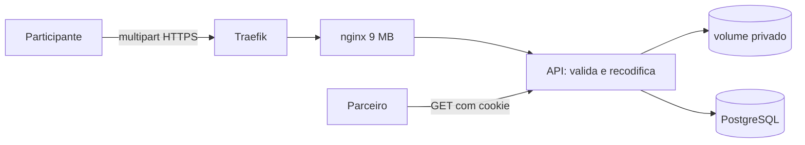

# Modelo de ameaças — Fotos privadas

## Ativos e dados
| Ativo | Classificação | Por que importa |
|---|---|---|
| Foto do manuscrito | sensível | mostra a letra e o texto íntegro, inclusive o que o autor marcou como privado |
| Foto de perfil | pessoal | identifica a pessoa |
| Arquivos no volume `fotos_data` | sensível | a cópia física; entra no backup |
| Metadados da imagem (EXIF, GPS) | sensível | revelariam lugar e aparelho; descartados |

## Fronteiras de confiança e fluxo de dados

## Ameaças (STRIDE por fluxo)
| ID | Fluxo | STRIDE | Ameaça | Prob. | Impacto | Risco | Controle(s) |
|---|---|---|---|---|---|---|---|
| THR-21 | envio | T/E | arquivo malicioso disfarçado de imagem (poliglota, HTML/SVG, trailer com código) | M | A | A | CTL-21 |
| THR-22 | envio | D | bomba de descompressão ou envio gigante derruba a API ou enche o disco | M | M | M | CTL-22 |
| THR-23 | entrega | I | participante troca o id e lê foto de outra pessoa ou de outro grupo (IDOR) | M | A | A | CTL-23 |
| THR-24 | entrega | I | foto exposta por URL pública, cache compartilhado ou tipo sniffado | B | A | M | CTL-24 |
| THR-25 | armazenamento | I | metadados (GPS) vazam pela imagem guardada | M | M | M | CTL-21 |
| THR-26 | backup | I | volume e dump ficam legíveis a outros usuários da VPS | B | A | M | CTL-25 |

## Controles
| ID | Controle | Atende | Teste/evidência |
|---|---|---|---|
| CTL-21 | decodificar e regravar a imagem com Pillow (tipo, dimensões e metadados definidos pelo servidor); recusar o que não decodifica como JPEG, PNG ou WebP; nome UUID | THR-21, THR-25, ABU-5, REQ-6.2, REQ-6.4 | `test_req_6_2_*`, `test_req_6_4_*`, `test_prop_5_*` |
| CTL-22 | `client_max_body_size 9m` só na rota de fotos; 8 MB e 4096 px conferidos antes de decodificar; `MAX_IMAGE_PIXELS`; cota de 20 envios por hora e 30 avulsas | THR-22, ABU-7, NFR-FOTO-2 | `test_ctl_22_*`, `test_req_6_3_*`, `test_abu_7_*` |
| CTL-23 | autorização por objeto: manuscrito só do dono; perfil só do dono ou do grupo; o resto 404 | THR-23, ABU-6, REQ-6.6, REQ-7.4 | `test_req_6_6_*`, `test_req_7_4_*` |
| CTL-24 | `Content-Type` fixado pelo servidor, `Cache-Control: private, no-store`, `X-Content-Type-Options: nosniff`, sem `static`/`media` público | THR-24, REQ-6.5, NFR-FOTO-1 | `test_req_6_5_*`, `test_ctl_24_*` |
| CTL-25 | volume em diretório de modo 700 do usuário do contêiner; backup em `~/backups` com modo 600 | THR-26 | `test_ctl_25_*` (texto do deploy); conferência no ar |

## Riscos residuais
- Imagem legítima mas muito pesada em pixels (até 4096 px) custa CPU e memória na recodificação: aceitável para 2 pessoas; uma recodificação por vez por processo.
- Quem administra a VPS lê os arquivos do volume (confiança no operador, ver ADR da 005).
