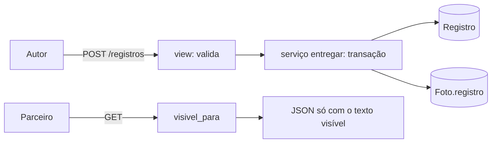

# Design — Registros diários (backend)

## 1. Visão geral
Novo app Django `registros`. Uma função pura, `visivel_para(registro, usuario)`, decide o que cada pessoa recebe; todas as rotas e o
serializador passam por ela (NFR-REG-1). A entrega é uma transação só: cria o registro, anexa as fotos e confere o dia.

## 2. Reuso e impacto
- `acesso`: grupo do usuário, `SessaoComCsrf`, 404 por grupo, formato de erro.
- `fotos` (004): `Foto` ganha FK nula `registro` e `ordem`; a regra "parceiro vê a foto se `full`" entra na view de entrega da foto
  (o contrato de visibilidade da foto é de `registros`, o módulo que o fornece).
- Nada muda no compose nem no nginx. O Admin **não** registra `Registro` (NFR-REG-4).

## 3. Pesquisa
- Python indexa `str` por ponto de código: fatiar `texto[inicio:fim]` já é a unidade decidida (ADR-0009).
- PostgreSQL: restrição única `(autor, data)` garante um registro por dia mesmo com pedidos simultâneos; `IntegrityError` vira 409.
- Dia em `America/Sao_Paulo`: `zoneinfo`, sem dependência nova; `data = entregue_em.astimezone(SP).date()`.
- Django `ATOMIC_REQUESTS` já envolve a requisição numa transação (tech.md).

## 4. Modelo de dados
| Modelo | Campos |
|---|---|
| `Registro` | `id` UUID PK · `grupo` FK · `autor` FK usuário · `data` DATE · `texto` TEXT · `visibilidade` (`full`/`private`/`partial`) · `trecho_inicio`, `trecho_fim` INT nulos · `entregue_em` timestamptz (servidor) |
| Restrições | `unique(autor, data)` · `check`: (`partial` ⇔ `trecho_inicio` e `trecho_fim` não nulos) e `trecho_inicio >= 0` e `trecho_fim > trecho_inicio` |
| `Foto` (da 004) | + `registro` FK nula (`PROTECT`), `ordem` SMALLINT |
Restrições do banco, além da aplicação (auditoria da 005): `visibilidade` só em `full`/`private`/`partial`; `trecho_fim <= char_length(texto)` (o PostgreSQL em UTF8 conta pontos de código, emoji é 1); na `Foto`, `registro` preenchido implica `anexada`. Índice `(grupo, data)` para a lista do mês.

## 5. Contratos
`contracts/openapi.yaml`. Rotas de `/api/v1`:
| Método e rota | O que faz |
|---|---|
| `POST /registros` `{texto, visibilidade, trecho?:{inicio,fim}, fotos:[id]}` | entrega; 201 com o registro na visão do autor |
| `GET /registros?mes=AAAA-MM` | registros do grupo no mês, na visão de quem pede |
| `GET /registros/{id}` | um registro, na visão de quem pede |
| `GET /fotos/{id}/arquivo` (da 004) | passa a aceitar o parceiro quando o registro da foto é `full` |
Visão do **autor**: `{id, data, entregue_em, visibilidade, trecho, texto, fotos:[id], autor:{nome,cor,foto_url}, meu:true}`.
Visão do **parceiro**: `{id, data, entregue_em, visibilidade_efetiva, texto_visivel, fotos:[id], autor:{nome,cor}, meu:false, aviso?}`
com `texto_visivel` = texto todo (`full`), o trecho (`partial`) ou `null` (`private`, com `aviso: "Enviado, mas mantido privado pelo autor"`);
`fotos` vazia fora do `full`; **sem** `trecho`, sem `texto` e sem tamanho do texto completo. `visibilidade_efetiva` é `full`, `partial` ou `private`.
Os métodos `PUT`, `PATCH` e `DELETE` em `/registros/{id}` respondem 405.

**Quem lê o quê quando alguém sai do grupo (auditoria da 005):** o autor lê sempre os próprios registros; o parceiro só lê se ele e o autor ainda estão no grupo do registro (`_pode_ler`, e a mesma conferência na foto). A lista é `autor = eu OU (grupo = o meu E o autor ainda está nele)`.

## 6. Fluxos e estados de UI
(Telas: 006.) A API responde o que a tela precisa: a lista já vem filtrada e ordenada; o 409 de "já entregou hoje" traz a mensagem pronta.

## 7. Tratamento de erros
| Situação | Resposta |
|---|---|
| Campo inválido (texto, trecho, fotos, mês) | 422 `{"campos":{...}}`; a mensagem nunca repete o texto enviado |
| Já entregou hoje | 409 `{"detalhe":"Você já entregou o registro de hoje."}` |
| Sem grupo | 409 `{"detalhe":"Entre em um grupo antes de escrever."}` |
| Registro ou foto que não é do grupo, ou foto escondida | 404 |
| Edição ou exclusão | 405 |

## 8. Propriedades de corretude
Prova de PROP-6: com textos sorteados formados por marcadores únicos (`«k»`) e trechos sorteados, o JSON serializado para o parceiro não contém marcador fora do texto visível.
Prova de PROP-7: para textos com emoji, acentos compostos, quebras de linha e tabulação, `texto_visivel == texto[inicio:fim]` em pontos de código.

## 9. Segurança (resumo — detalhe em threat-model.md)
Função única de visibilidade; 404 por objeto; foto escondida = 404; nenhuma serialização do campo `texto` fora do `visivel_para` (teste de código); Admin sem registros;
log sem texto; mensagens de erro sem eco do texto.

## 10. Estratégia de testes
Os testes levam `[005]` na docstring; pasta `backend/apps/registros/tests/`.
| Teste | Prova |
|---|---|
| `test_req_8_1_entrega_*`, `test_req_8_2_fotos_*`, `test_req_8_3_texto_*`, `test_req_8_4_trecho_*` | REQ-8.1 a 8.4, ABU-11 |
| `test_req_8_5_um_por_dia_*` (e `test_abu_9_*` com threads reais), `test_req_8_6_*`, `test_req_8_7_imutavel_*` | REQ-8.5 a 8.7, ABU-9 |
| `test_req_9_1_*` a `test_req_9_6_*` | US-9 |
| `test_req_9_7_nenhum_ponto_vaza_*`: registro `private` e `partial` lidos como parceiro por todas as rotas, erros e lista | REQ-9.7, ABU-8, Art. 12 |
| `test_req_10_*` | US-10 |
| `test_abu_10_*` | ABU-10 |
| `test_prop_6_*`, `test_prop_7_*` | PROP-6, PROP-7 |
| `test_nfr_reg_1_*` (varredura do código: só `visivel_para` lê `.texto`), `test_nfr_reg_3_*`, `test_nfr_reg_4_*` | NFR-REG-1, 3, 4 |
Mutação (Testing.md pedia avaliar): mutar `visivel_para` (devolver o texto inteiro no `partial`, devolver foto no `partial`, trocar `<` por `<=`) e provar que os testes falham.

## 11. Observabilidade
Log da entrega: id do registro, autor (id), visibilidade e quantidade de fotos; nunca texto, tamanho do texto, trecho ou nome de foto.

## 12. Decisões
| ADR | Decisão |
|---|---|
| ADR-0009 | offsets em pontos de código Unicode, texto guardado sem normalização; o front converte de e para UTF-16 |
| ADR-0010 | confiança no operador; sem criptografia por usuário no MVP; Admin não mostra registros |

## 13. Portões da constituição
| Art. | Atende? |
|---|---|
| 4 Simplicidade | sim: um app, um modelo, uma função de visibilidade; sem rascunho |
| 5 Anti-abstração | sim: ORM e DRF direto |
| 6 Validação no backend | sim |
| 7 Segurança | sim: deny-by-default; 404 por objeto |
| 9 Privacidade | sim: log sem conteúdo; Admin sem texto |
| 12 Privacidade filtrada | sim: `visivel_para` único, com teste por rota |
| 13 Grupo de até 2 | sim: o registro é do grupo; a leitura entre pares usa o grupo |

## 14. Rastreamento de complexidade
Sem exceção. Diferenças em relação ao modelo da origem, com motivo: sem `status`/rascunho (entrega atômica); `visible_*_offset` viram `trecho_*`; `body` vira `texto`.

## 15. Riscos e rollback
Risco: erro de regra num caminho novo expõe texto — mitigado por função única, teste por rota e mutação. Risco: o front calcular offsets em UTF-16 e enviar errado — o servidor
valida o intervalo, e a 006 testa a conversão com emoji. Rollback: reverter a migração (apaga os registros; só antes de haver uso real).
