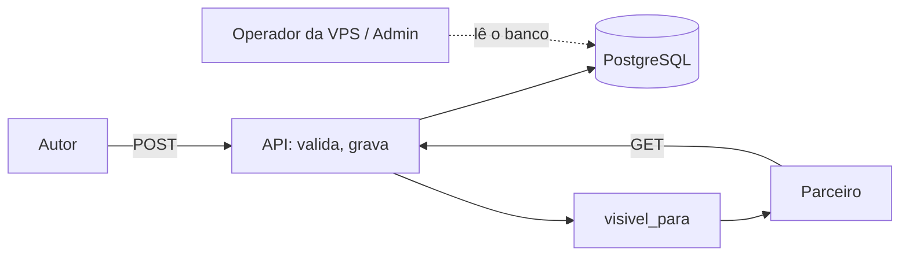

# Modelo de ameaças — Registros diários (backend)

## Ativos e dados
| Ativo | Classificação | Por que importa |
|---|---|---|
| Texto do registro | sensível | é o diário íntimo; a regra de visibilidade existe para protegê-lo |
| Trecho e visibilidade | sensível | o tamanho e a posição do trecho revelam o que foi escondido |
| Fotos do manuscrito | sensível | mostram o texto inteiro |
| Data e hora da entrega | pessoal | alimentam calendário e hábito |

## Fronteiras de confiança e fluxo de dados

## Ameaças (STRIDE por fluxo)
| ID | Fluxo | STRIDE | Ameaça | Prob. | Impacto | Risco | Controle(s) |
|---|---|---|---|---|---|---|---|
| THR-31 | leitura pelo parceiro | I | texto `private` ou fora do trecho aparece em alguma resposta (rota nova, serializador, erro, lista, ordenação) | M | A | A | CTL-31, CTL-32 |
| THR-32 | leitura da foto | I | foto de registro `partial` ou `private` entregue ao parceiro | M | A | A | CTL-33 |
| THR-33 | metadados da resposta | I | tamanho do texto, posição do trecho ou contagem de caracteres revelam o escondido | M | M | M | CTL-31 |
| THR-34 | entrega | T/E | dois pedidos simultâneos criam dois registros no dia, burlando o hábito e a unicidade | B | M | B | CTL-34 |
| THR-35 | troca de id | I | participante lê registro ou foto de outro grupo | M | A | A | CTL-35 |
| THR-36 | entrega | T | foto de outra pessoa anexada ao próprio registro, ou foto reaproveitada | B | A | M | CTL-36 |
| THR-37 | logs e Admin | I | texto aparece em log, mensagem de erro ou no Admin do Django | M | A | A | CTL-37 |
| THR-38 | operador | I | quem administra a VPS lê o banco | A | A | A | CTL-39 |
| THR-39 | entrega | T | trecho inválido (negativo, gigante, invertido) causa erro 500 ou corte errado | M | M | M | CTL-38 |

## Controles
| ID | Controle | Atende | Teste/evidência |
|---|---|---|---|
| CTL-31 | função única `visivel_para`; a resposta do parceiro não tem `texto`, `trecho` nem tamanho do texto completo | THR-31, THR-33, REQ-9.3, REQ-9.4, REQ-9.7, NFR-REG-1, PROP-6 | `test_req_9_7_*`, `test_prop_6_*`, `test_nfr_reg_1_*` |
| CTL-32 | todo endpoint que devolve dado de registro tem teste que lê `private` e `partial` como parceiro e confere ausência dos marcadores escondidos (Art. 12); mutação da regra | THR-31, ABU-8 | `test_req_9_7_*`; roteiro de mutação (T-2.6) |
| CTL-33 | foto só é entregue ao parceiro se o registro for `full`; em qualquer outro caso, 404 | THR-32, REQ-9.5 | `test_req_9_5_*` |
| CTL-34 | `unique(autor, data)` no banco; `IntegrityError` → 409 | THR-34, REQ-8.5, ABU-9 | `test_abu_9_*` (threads reais) |
| CTL-35 | toda consulta filtrada pelo grupo; o que é de outro grupo responde 404 | THR-35, ABU-10, REQ-9.6 | `test_abu_10_*`, `test_req_9_6_*` |
| CTL-36 | as fotos precisam ser do autor, de manuscrito, avulsas, de 1 a 3, na mesma transação | THR-36, REQ-8.2 | `test_req_8_2_*` |
| CTL-37 | log sem texto, trecho ou nome de foto; Admin não registra `Registro`; erros de validação não repetem o texto | THR-37, NFR-REG-3, NFR-REG-4 | `test_nfr_reg_3_*`, `test_nfr_reg_4_*` |
| CTL-38 | validação do intervalo contra o tamanho do texto em pontos de código; tipos inteiros estritos; 422, nunca 500 | THR-39, REQ-8.4, ABU-11 | `test_req_8_4_*`, `test_abu_11_*` |
| CTL-39 | risco aceito e registrado no ADR-0010; Admin sem registros e fotos, log sem conteúdo, backups com modo 600 | THR-38, NFR-REG-4 | `test_nfr_reg_4_*`; ADR-0010 aceito pelo dono |

## Riscos residuais
- **O operador lê o banco** (THR-38): uma das duas pessoas administra a VPS. Aceito no MVP (ADR-0010); revisitar se o produto sair do círculo de duas pessoas de confiança.
- Quem tem a senha da pessoa vê tudo que ela vê; recuperação de senha por e-mail (011) concentra esse risco no e-mail.
