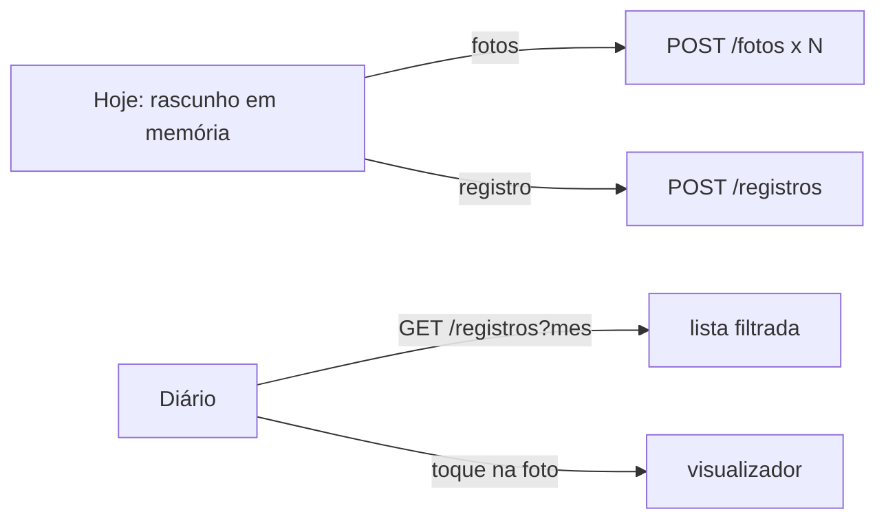

# Design — Registros diários (telas)

## 1. Visão geral
Duas features novas no app Flutter: `features/hoje` (escrever e entregar) e `features/diario` (ler). Um utilitário puro, `shared/texto.dart`, faz a conversão
UTF-16 ↔ pontos de código e o ajuste a grafemas. A API é a da 005; o cliente `Api` ganha `entregarRegistro`, `listarRegistros`, `lerRegistro`, `enviarFoto`.

## 2. Reuso e impacto
- Reusa `ApiHttp` (CSRF, erros), `Sessao`, o roteador por fragmento e o tema da 003; o `NavigationBar` ganha dois destinos.
- `ApiFalsa` dos testes ganha os métodos novos. Pacotes novos: `image_picker` (ADR-0008) e `characters` (ADR-0011).
- Nenhuma mudança de backend, compose ou nginx.

## 3. Pesquisa
- `TextField` expõe `TextSelection` em unidades UTF-16 (`baseOffset`, `extentOffset`); o texto da prévia sai de `String.substring` nesses índices.
- O pacote `characters` (do SDK do Flutter) percorre grafemas; usado para empurrar a seleção para fronteiras de grafema.
- `SelectableText`/`Text` desenham o texto como glifos, nunca como HTML (NFR-TELA-2).
- `image_picker` na web devolve `XFile` com `readAsBytes()`; limite de 8 MB checado no app antes de enviar (a regra de verdade é a da 004).

## 4. Modelo de dados
Sem banco. Modelos Dart: `Registro` (campos das duas visões da 005, com `meu`), `Rascunho` (texto, visibilidade, trecho em UTF-16 e em pontos, fotos escolhidas e ids já enviados).

## 5. Contratos
Consome `005-registros-backend/contracts/openapi.yaml` e `004-fotos/contracts/openapi.yaml`; não cria contrato.

## 6. Fluxos e estados de UI
- **Hoje, sem entrega:** texto → fotos (1–3, com prévia e remover) → "Quem pode ler?" (3 opções, nenhuma marcada) → se "só um trecho": selecionar no campo e "Usar a seleção" → prévia → Entregar (desabilitado com a lista do que falta) → confirmação → carregando ("Enviando fotos 1 de 2…") → "Registro entregue".
- **Hoje, com entrega:** mostra o registro do dia (visão do autor) e o estado da outra pessoa (entregou / ainda não / privado).
- **Diário:** cabeçalho com mês e setas; lista de cartões; estado vazio; erro com "Tentar de novo".
- **Registro:** cartão com faixa na cor do autor; foto em miniatura; tela cheia com zoom.
- **Erros:** mensagem em português do servidor; falha de rede: "Sem conexão. Seus dados continuam aqui."

## 7. Tratamento de erros
422 → mensagens sob os campos; 409 do dia → REQ-11.8; 401 → entrar; falha de foto → botão "Tentar de novo" que só reenvia o que falta.

## 8. Propriedades de corretude
PROP-8: sorteio de textos (ASCII, emoji, acentos compostos, quebras, bandeiras) e seleções; `paraPontos(paraUtf16(i)) == i` nos limites de ponto de código, e
`fatiaPorPontos(texto, ini, fim) == previa` para o mesmo trecho.

## 9. Segurança (resumo — detalhe em threat-model.md)
Sem persistência local do texto; prévia exata; confirmação; nada de HTML; um único pedido de entrega por vez; sem texto em log do console.

## 10. Estratégia de testes
Testes `[006]` em `frontend/test/` (widget, com `ApiFalsa`) e `frontend/test/texto_test.dart` (unidade).
| Teste | Prova |
|---|---|
| `hoje_test.dart`: `REQ-11.1`, `11.2`, `11.5`, `11.6`, `11.7`, `11.8` | US-11 |
| `trecho_test.dart`: `REQ-11.3`, `11.4`, prévia exata, emoji | REQ-11.3, 11.4, PROP-8 |
| `sem_persistencia_test.dart`: nenhum acesso a armazenamento do navegador (varredura do código) e nada gravado após entregar | REQ-11.9, CTL-41 |
| `duplo_toque_test.dart` | ABU-12, CTL-44 |
| `diario_test.dart`: `REQ-12.1` a `12.7`, texto com marcação literal (`ABU-13`) | US-12, NFR-TELA-2 |
| `texto_test.dart` | PROP-8 |
| `acessibilidade_test.dart` (estende o da 003): guias de contraste e alvo de toque nas telas novas, 360 e 1280 px, claro e escuro | NFR-TELA-1, NFR-TELA-3 |
| E2E no navegador, em contêiner (T-3.4) | tudo junto |

## 11. Observabilidade
Nenhum log do texto; o app não envia telemetria.

## 12. Decisões
| ADR | Decisão |
|---|---|
| ADR-0011 | pacote `characters` (do SDK) para fronteiras de grafema |
(O `image_picker` já está no ADR-0008.)

## 13. Portões da constituição
| Art. | Atende? |
|---|---|
| 4, 5 | sim: Riverpod e widgets do Flutter direto; sem camada de armazenamento |
| 6 | sim: as regras de verdade estão na 005; o app só antecipa a mensagem |
| 9 Privacidade | sim: nada persistido; sem telemetria |
| 10 Acessibilidade | sim: NFR-TELA-1 e 3 com teste |
| 11 Dependências | sim: ADR-0008 e ADR-0011 |
| 12 | sim: o app só mostra o que a API devolve; prévia exata |

## 14. Rastreamento de complexidade
Sem exceção.

## 15. Riscos e rollback
Risco: seleção em campo multilinha no celular difere entre navegadores (testar no Chrome Android e no Safari iOS na T-3.4). Risco: o corte no meio de um grafema
(mitigado por `characters`). Rollback: retirar os dois destinos da navegação; a 005 continua intacta.
