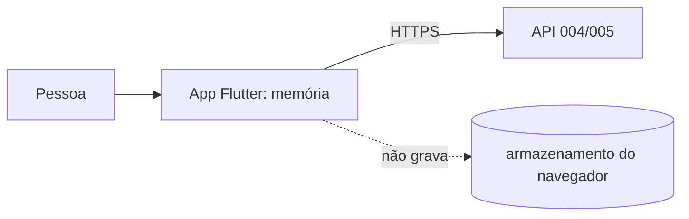

# Modelo de ameaças — Registros diários (telas)

## Ativos e dados
| Ativo | Classificação | Por que importa |
|---|---|---|
| Rascunho do texto (memória do app) | sensível | texto íntimo antes de a pessoa decidir quem lê |
| Trecho escolhido | sensível | decide o que o parceiro vê; um erro de posição expõe o que era para ficar escondido |
| Fotos escolhidas | sensível | mostram o texto inteiro |

## Fronteiras de confiança e fluxo de dados

## Ameaças (STRIDE por fluxo)
| ID | Fluxo | STRIDE | Ameaça | Prob. | Impacto | Risco | Controle(s) |
|---|---|---|---|---|---|---|---|
| THR-41 | rascunho | I | texto fica em armazenamento do navegador, em aparelho compartilhado, e outra pessoa o lê | M | A | A | CTL-41 |
| THR-42 | trecho | T/I | conversão UTF-16 → pontos de código erra e o parceiro lê um caractere a mais (ou a menos) | M | A | A | CTL-42 |
| THR-43 | exibição | T | texto de registro com marcação é interpretado como HTML (XSS) | B | A | M | CTL-43 |
| THR-44 | entrega | R | toque duplo ou erro de rede cria entrega repetida; ou entrega irreversível por engano | M | M | M | CTL-44 |
| THR-45 | foto | I | foto visível a quem não deveria aparecer na tela (cache do navegador) | B | M | B | CTL-45 |

## Controles
| ID | Controle | Atende | Teste/evidência |
|---|---|---|---|
| CTL-41 | rascunho só em memória; nenhum uso de `localStorage`, `sessionStorage`, IndexedDB, cookie próprio ou `shared_preferences` | THR-41, REQ-11.9 | `sem_persistencia_test.dart` (varredura do código e do que fica gravado) |
| CTL-42 | função única e testada de conversão; ajuste a grafemas; prévia exata mostrada antes de entregar; o servidor valida o intervalo | THR-42, REQ-11.3, REQ-11.4, PROP-8 | `texto_test.dart`, `trecho_test.dart`; E2E com emoji |
| CTL-43 | o texto é desenhado por `Text`/`SelectableText`, nunca como HTML; CSP restritivo da 003 | THR-43, NFR-TELA-2, ABU-13 | `diario_test.dart` (texto com marcação) |
| CTL-44 | confirmação antes de enviar; botão desabilitado durante o envio; um único pedido de registro | THR-44, REQ-11.5, ABU-12 | `hoje_test.dart`, `duplo_toque_test.dart` |
| CTL-45 | foto servida pela 004 com `Cache-Control: private, no-store` e só do que a API permitir | THR-45 | `test_req_6_5_*` (da 004); E2E |

## Riscos residuais
- A prévia mostra o que o app calculou; se o app calcular errado nos dois lados (prévia e envio), a pessoa confirma uma coisa errada. A prova disso é o teste de PROP-8 e o E2E com emoji.
- Extensões do navegador e o teclado do aparelho (sugestões, histórico de digitação) estão fora do alcance do app.
