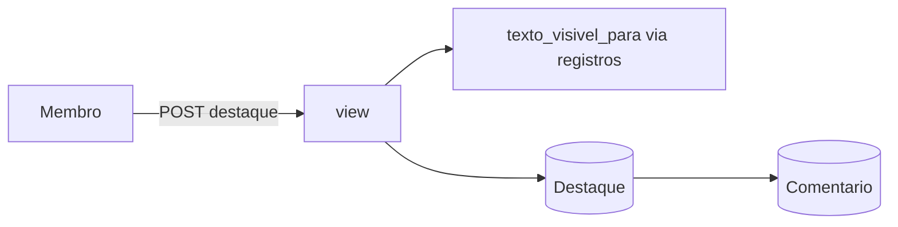

# Design — Destaques e comentários (backend)

## 1. Visão geral
Novo app Django `destaques`. Toda validação de posição usa o **texto visível** calculado por `registros.domain.visivel_para` (005); o app nunca lê `Registro.texto`
diretamente. O trecho destacado é calculado na saída, não guardado.

## 2. Reuso e impacto
- Usa a função de visibilidade e o isolamento por grupo da 005; `acesso` para nome e cor.
- Nada muda no compose, no nginx nem no Admin (o app não registra modelos).
- Para não abrir uma segunda porta ao `Registro.texto` (NFR-REG-1 da 005), a 005 expõe `texto_visivel_para(registro, usuario)`; esta mudança só a chama.

## 3. Pesquisa
- Contar o limite de 50 sem corrida: travar a linha do registro (`select_for_update`) dentro da transação, contar e inserir; o limite de 20 usa a trava no destaque.
- Posição como inteiro estrito (`int`, não `bool`, sem `str`), para recusar `"1"`, `1.5`, `true`.
- O erro de posição fala só do texto visível: "A posição precisa estar entre 0 e N" com N = tamanho do texto **visível**.

## 4. Modelo de dados
| Modelo | Campos |
|---|---|
| `Destaque` | `id` UUID PK · `registro` FK (`CASCADE`) · `autor` FK · `inicio`, `fim` INT · `criado_em` |
| `Comentario` | `id` UUID PK · `destaque` FK (`CASCADE`) · `autor` FK · `texto` TEXT · `criado_em` · `editado_em` nulo |
| Restrições | `check(inicio >= 0 and fim > inicio)`; índice `(registro, autor)` e `(destaque, criado_em)` |

## 5. Contratos
`contracts/openapi.yaml`. Rotas de `/api/v1`:
| Método e rota | O que faz |
|---|---|
| `GET /registros/{id}/destaques` | lista destaques com comentários, na visão de quem pede |
| `POST /registros/{id}/destaques` `{inicio, fim, comentario?}` | cria |
| `DELETE /destaques/{id}` | apaga (só o autor) |
| `POST /destaques/{id}/comentarios` `{texto}` | comenta |
| `PATCH /comentarios/{id}` `{texto}` | edita (só o autor) |
| `DELETE /comentarios/{id}` | apaga (só o autor) |
Destaque: `{id, inicio, fim, trecho, autor:{nome,cor}, meu, criado_em, comentarios:[{id, texto, autor:{nome,cor}, meu, criado_em, editado_em}]}`.

## 6. Fluxos e estados de UI
(Telas: 008.) A API devolve tudo de um registro numa chamada (≤ 100 destaques com ≤ 20 comentários cada).

## 7. Tratamento de erros
| Situação | Resposta |
|---|---|
| Posição ou texto inválido | 422 `{"campos":{...}}`, sem eco do texto |
| Registro sem texto visível | 409 `{"detalhe":"Este registro não tem texto para destacar."}` |
| Limite de 50 ou 20 | 409 |
| Mexer no que é de outro autor | 403 `{"detalhe":"Só quem escreveu pode fazer isso."}` |
| De outro grupo ou inexistente | 404 |

## 8. Propriedades de corretude
PROP-9: com textos de marcadores únicos, visibilidades `full` e `partial` e posições sorteadas válidas, `trecho == texto_visivel[inicio:fim]` e nenhum marcador escondido aparece no JSON.

## 9. Segurança (resumo — detalhe em threat-model.md)
Posição só contra o texto visível; erro sem tamanho do texto completo; autoria conferida por objeto; limites com trava; Admin sem destaques; log sem texto.

## 10. Estratégia de testes
Testes `[007]` em `backend/apps/destaques/tests/`.
| Teste | Prova |
|---|---|
| `test_req_13_1_*`, `13_2_*` (inclui tipos errados e fora do visível), `13_3_*`, `13_4_*` | US-13 |
| `test_req_13_5_*` e `test_abu_15_*` (threads reais) | REQ-13.5, ABU-15 |
| `test_req_13_6_*`, `test_req_13_7_*`, `test_abu_16_*` | REQ-13.6, 13.7, ABU-16 |
| `test_req_14_*` | US-14 |
| `test_abu_14_*`: parceiro em registro `partial` tenta posições além do trecho; as mensagens e as listas não trazem o escondido nem o tamanho total | ABU-14, Art. 12 |
| `test_prop_9_*` | PROP-9 |
| `test_nfr_dest_*` (Admin vazio, log) | NFR-DEST-2, REQ-14.7 |
Mutação: validar contra o texto integral em vez do visível; deixar o tamanho total na mensagem; trocar a checagem de autoria. Todos os mutantes devem ser mortos.

## 11. Observabilidade
Log: ids e contagens; nunca texto de comentário ou trecho.

## 12. Decisões
Sem ADR novo. Registra em ADR-0009 (da 005) que, para destaques, os offsets são relativos ao texto visível.

## 13. Portões da constituição
| Art. | Atende? |
|---|---|
| 4, 5 | sim: dois modelos, ORM/DRF direto |
| 6 | sim |
| 7 | sim: autoria por objeto; 404 por grupo |
| 9 | sim: sem conteúdo em log |
| 12 | sim: tudo sai do texto visível; teste da sonda |
| 13 | sim: isolamento por grupo |

## 14. Rastreamento de complexidade
Sem exceção. Diferença da origem: `highlighted_text` não é guardado (calculado).

## 15. Riscos e rollback
Risco: uma segunda rota expor `texto` — mitigado pela função única da 005. Rollback: reverter a migração (apaga destaques e comentários).
