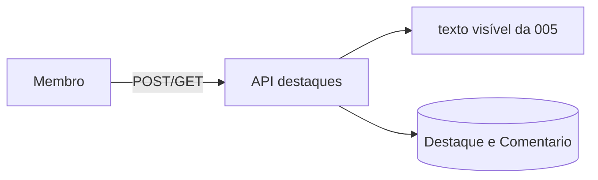

# Modelo de ameaças — Destaques e comentários (backend)

## Ativos e dados
| Ativo | Classificação | Por que importa |
|---|---|---|
| Texto dos comentários | sensível | conversa íntima sobre o diário |
| Posição dos destaques | sensível | mostra o que a pessoa achou importante |
| Texto escondido do registro | sensível | não pode ser deduzido pelas posições nem pelas mensagens |

## Fronteiras de confiança e fluxo de dados

## Ameaças (STRIDE por fluxo)
| ID | Fluxo | STRIDE | Ameaça | Prob. | Impacto | Risco | Controle(s) |
|---|---|---|---|---|---|---|---|
| THR-51 | criar destaque | I | parceiro usa posições e as mensagens de erro como sonda para descobrir o tamanho ou o conteúdo do texto escondido | M | A | A | CTL-51 |
| THR-52 | listar | I | trecho destacado ou comentário de registro `private` ou de outro grupo aparece | B | A | M | CTL-52 |
| THR-53 | editar e apagar | E | uma pessoa altera ou apaga o comentário ou o destaque da outra | M | M | M | CTL-53 |
| THR-54 | criar | D | volume de destaques e comentários enche o banco ou a tela | M | B | B | CTL-54 |
| THR-55 | logs e Admin | I | texto de comentário ou trecho aparece em log, erro ou Admin | M | A | A | CTL-55 |
| THR-56 | segunda porta ao texto | I | este app lê `Registro.texto` direto e ignora a visibilidade | B | A | M | CTL-56 |

## Controles
| ID | Controle | Atende | Teste/evidência |
|---|---|---|---|
| CTL-51 | posição validada só contra o texto visível; mensagens citam apenas o tamanho do visível; inteiros estritos | THR-51, ABU-14, REQ-13.2 | `test_abu_14_*`, `test_req_13_2_*` |
| CTL-52 | todo acesso passa pelo registro do grupo e pela visibilidade; `private` → 409; outro grupo → 404 | THR-52, REQ-13.3, REQ-14.6 | `test_req_13_3_*`, `test_req_14_6_*` |
| CTL-53 | autoria conferida no objeto; 403 sem alterar | THR-53, ABU-16, REQ-13.7, REQ-14.3 | `test_abu_16_*`, `test_req_13_7_*` |
| CTL-54 | 50 destaques por pessoa por registro e 20 comentários por destaque, com trava de linha | THR-54, ABU-15, REQ-13.5, REQ-14.2 | `test_abu_15_*` (threads reais) |
| CTL-55 | log só com ids e contagens; erros sem eco; Admin sem os modelos | THR-55, REQ-14.7, NFR-DEST-2 | `test_nfr_dest_*` |
| CTL-56 | o app só usa `texto_visivel_para`; varredura de código proíbe `.texto` de `Registro` fora de `registros` | THR-56, PROP-9 | `test_nfr_dest_*`, `test_prop_9_*` |

## Riscos residuais
Quem destaca vê o texto visível inteiro por definição; o comentário vale para as duas pessoas e fica até o autor apagar. O operador lê o banco (ADR-0010).
