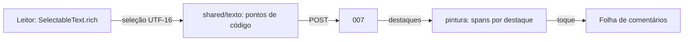

# Design — Destaques e comentários (telas)

## 1. Visão geral
A tela de registro (006) troca o `Text` do texto visível por um leitor que desenha `TextSpan`s: o texto é fatiado nas bordas dos destaques e cada pedaço leva o
fundo e o sublinhado de quem destacou. A seleção usa `SelectableText.rich`; um `contextMenuBuilder` próprio acrescenta "Destacar" e "Destacar e comentar".

## 2. Reuso e impacto
- Reusa `shared/texto.dart` e `characters` (006), `ApiHttp`, `Sessao`, tema e a tela de registro; `ApiFalsa` ganha os métodos da 007.
- Sem pacote novo, sem mudança de backend, compose ou nginx.

## 3. Pesquisa
- `SelectableText.rich` expõe `TextSelection` em UTF-16 e aceita `TextSpan` com `recognizer` (toque) por pedaço; `contextMenuBuilder` permite acrescentar ações.
- Contraste do texto sobre o fundo: alfa baixo (≈ 0,28) sobre o tema; o teste mede o contraste efetivo composto com a cor de fundo do tema.
- Destaques sobrepostos: fatiar nas bordas de todos e, por pedaço, desenhar o mais curto por cima; o toque resolve pelo menor intervalo que contém o ponto.

## 4. Modelo de dados
Modelos Dart `Destaque` e `Comentario` (campos da 007). Sem banco.

## 5. Contratos
Consome `007-destaques-backend/contracts/openapi.yaml`; não cria contrato.

## 6. Fluxos e estados de UI
- **Selecionar:** menu com Destacar / Destacar e comentar → (com comentário) abre a folha já com o campo → envia → trecho marcado.
- **Ler:** trechos marcados; toque abre a folha (comentários do mais curto e seletor dos outros).
- **Folha:** cabeçalho com o trecho destacado; conversa (cor e nome de cada um); campo "Comentar"; para o dono: "Editar" no próprio comentário, "Apagar" comentário, "Apagar destaque" (confirmação).
- **Estados:** carregando, erro com "Tentar de novo", limite atingido (mensagem), registro sem texto visível (sem ação).

## 7. Tratamento de erros
409 de limite → "Você já fez 50 destaques neste registro." / "Esse destaque já tem 20 comentários."; 403 → "Só quem escreveu pode fazer isso."; 401 → entrar; rede → "Sem conexão."

## 8. Propriedades de corretude
PROP-10: textos e destaques sorteados (emoji, acentos compostos, quebras); para cada destaque, o texto dos spans pintados concatenados igual a `trecho` e posição dentro do texto igual a `inicio`.

## 9. Segurança (resumo — detalhe em threat-model.md)
Sem HTML; sem armazenamento local; um pedido por ação; só o que a API devolveu.

## 10. Estratégia de testes
Testes `[008]` em `frontend/test/`.
| Teste | Prova |
|---|---|
| `destaque_selecao_test.dart`: menu, posições enviadas, limites de grafema, fora do visível | REQ-15.1, REQ-15.2, REQ-15.9 |
| `destaque_pintura_test.dart`: spans, cor, sublinhado, sobreposição, contraste ≥ 4,5, PROP-10 | REQ-15.3, REQ-15.7, PROP-10 |
| `destaque_folha_test.dart`: abrir, comentar, editar, apagar, confirmação, erros, marcação literal, duplo toque | REQ-15.4 a 15.8, ABU-17, ABU-18 |
| `acessibilidade_test.dart` (estende): rótulos, teclado, 360 e 1280 px, claro e escuro | NFR-DESTF-1, NFR-DESTF-3 |
| E2E no navegador, em contêiner, com dois participantes | tudo junto |

## 11. Observabilidade
Nenhum log de texto.

## 12. Decisões
Sem ADR novo.

## 13. Portões da constituição
| Art. | Atende? |
|---|---|
| 4, 5 | sim: widgets do Flutter direto |
| 6 | sim: as regras são as da 007 |
| 9, 12 | sim: o app só mostra o que a API devolveu |
| 10 | sim: cor mais sublinhado, rótulos, teclado |

## 14. Rastreamento de complexidade
Sem exceção.

## 15. Riscos e rollback
Risco: menu de seleção diferente entre Chrome Android, Safari iOS e desktop (testar nos três na T-3.1). Risco: sobreposições complicam a pintura (testes por caso). Rollback: voltar ao `Text` simples; a 007 continua intacta.
