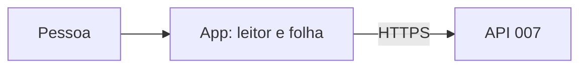

# Modelo de ameaças — Destaques e comentários (telas)

## Ativos e dados
| Ativo | Classificação | Por que importa |
|---|---|---|
| Texto visível e comentários na tela | sensível | conteúdo íntimo; só o que a API devolveu |
| Seleção do destaque | sensível | a posição enviada define o trecho marcado |

## Fronteiras de confiança e fluxo de dados

## Ameaças (STRIDE por fluxo)
| ID | Fluxo | STRIDE | Ameaça | Prob. | Impacto | Risco | Controle(s) |
|---|---|---|---|---|---|---|---|
| THR-61 | exibição | T | comentário ou texto com marcação é interpretado como HTML (XSS) | B | A | M | CTL-61 |
| THR-62 | seleção | T | conversão errada marca um trecho diferente do selecionado, ou fora do texto visível | M | M | M | CTL-62 |
| THR-63 | folha | R | toque duplo cria destaque ou comentário repetido | M | B | B | CTL-63 |

## Controles
| ID | Controle | Atende | Teste/evidência |
|---|---|---|---|
| CTL-61 | texto desenhado como texto; CSP restritivo da 003 | THR-61, ABU-17, NFR-DESTF-2 | `destaque_folha_test.dart` |
| CTL-62 | uma função de conversão testada (da 006); ajuste a grafemas para dentro; a pintura usa o `trecho` devolvido pela API como verdade | THR-62, REQ-15.2, PROP-10 | `destaque_selecao_test.dart`, `destaque_pintura_test.dart` |
| CTL-63 | botão desabilitado durante o envio; um pedido por ação | THR-63, ABU-18 | `destaque_folha_test.dart` |

## Riscos residuais
O menu de seleção varia por navegador; a ação nunca expõe mais que a API já entregou, pois o app só marca texto que a pessoa já enxerga.
