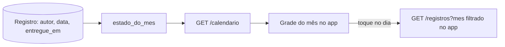

# Design — Calendário (backend e telas)

## 1. Visão geral
Uma função pura, `estado_do_mes(entregas, membros, hoje, mes)`, calcula os estados a partir dos registros; uma view fina a chama. O app ganha a aba Calendário (5º destino).
Não há tabela de calendário: tudo é derivado dos registros da 005.

## 2. Reuso e impacto
- `registros.Registro` (data e `entregue_em`), `acesso.Perfil` (nome, cor, **novo `entrou_em`**), grupo e sessão da 003.
- Migração em `acesso`: `Perfil.entrou_em` (nulo→preenchido): contas existentes recebem a data de criação do usuário; quem entra por convite ou cria grupo passa a gravá-la.
- Front: aba nova e uma feature `calendario`; reaproveita o cartão de registro da 006 na lista do dia.
- Sem compose, nginx nem dependência nova.

## 3. Pesquisa
- `zoneinfo.ZoneInfo("America/Sao_Paulo")` (sem horário de verão desde 2019, mas o código não assume); o dia de uma entrega é `entregue_em.astimezone(SP).date()`, já gravado em `Registro.data` pela 005; a 009 **usa `Registro.data`**, não recalcula.
- `juntos`: diferença absoluta entre os `entregue_em` do mesmo dia ≤ 7200 s.
- Consulta: um `filter(grupo, data__range)` com `values(autor_id, data, entregue_em)`; membros em outra consulta; hoje em Python: 2 a 3 consultas (NFR-CAL-3).

## 4. Modelo de dados
`Perfil.entrou_em` (DATE, nulo só durante a migração; preenchido para todos). Nada mais. A 005 já tem índice `(grupo, data)`.

## 5. Contratos
`contracts/openapi.yaml`. Rota de `/api/v1`:
| Método e rota | O que faz |
|---|---|
| `GET /calendario?mes=AAAA-MM` | `{mes, hoje, membros:[{nome,cor,foto_url?}], dias:[{data, estados:[…], juntos}]}` com `estados[i]` ∈ `escreveu`/`falhou`/`pendente`/`fora`, alinhado a `membros[i]` |
Sem horários, sem texto, sem visibilidade, sem e-mail.

## 6. Fluxos e estados de UI
Grade de 7 colunas (domingo primeiro, nome do dia abreviado), mês e setas; marcadores por membro: ● preenchido, ⊗ vazado com ×, ◌ tracejado, vazio (fora); selo "juntos" (dois círculos sobrepostos). Toque abre a folha do dia. Legenda embaixo. Estados: carregando, erro, sem grupo ("Entre em um grupo para ver o calendário").

## 7. Tratamento de erros
| Situação | Resposta |
|---|---|
| Mês inválido, futuro ou anterior à entrada | 422 `{"campos":{"mes":[…]}}` |
| Sem sessão | 401 |

## 8. Propriedades de corretude
PROP-11: oráculo independente em teste (definição direta das regras) comparado à função, com entregas sorteadas em torno da meia-noite e das bordas de 2 horas (7199, 7200, 7201 s).
PROP-12: troca de quem entrega primeiro não muda `juntos`; `juntos` implica os dois `escreveu`.

## 9. Segurança (resumo — detalhe em threat-model.md)
Só o grupo da pessoa; resposta mínima (sem horário nem texto); mês validado.

## 10. Estratégia de testes
Testes `[009]` em `backend/apps/calendario/tests/` e `frontend/test/`.
| Teste | Prova |
|---|---|
| `test_req_16_1_*` a `16_5_*` | REQ-16.1 a 16.5 |
| `test_req_16_6_sem_horarios_*` | REQ-16.6 |
| `test_req_16_7_*`, `16_8_*` | REQ-16.7, 16.8 |
| `test_req_16_9_*`, `test_abu_20_*`: 23:59:59 e 00:00:00 de São Paulo, UTC virando o dia, entrada no meio do mês | REQ-16.9, ABU-20 |
| `test_abu_19_*` | ABU-19 |
| `test_prop_11_*`, `test_prop_12_*` | PROP-11, PROP-12 |
| `test_nfr_cal_3_*` (`assertNumQueries`) | NFR-CAL-3 |
| Flutter: `calendario_test.dart`, `calendario_a11y_test.dart` | REQ-17.1 a 17.6, NFR-CAL-1 |

## 11. Observabilidade
Sem log de conteúdo; log de erro de validação com o mês pedido.

## 12. Decisões
Sem ADR novo. Fuso fixo registrado nas suposições (herdado da 003).

## 13. Portões da constituição
| Art. | Atende? |
|---|---|
| 4, 5 | sim: função pura e uma view; derivado, sem tabela |
| 6 | sim |
| 7 | sim: só o próprio grupo |
| 9 | sim: sem horário nem texto na resposta |
| 10 | sim: forma e texto além da cor |
| 13 | sim |

## 14. Rastreamento de complexidade
Sem exceção.

## 15. Riscos e rollback
Risco: fuso fixo errado para quem viaja (aceito, revisitar com fuso por pessoa). Risco: contas antigas com `entrou_em` aproximado: pode marcar `fora` um dia que a pessoa já escrevia; só afeta dias anteriores à 004 (sem registros). Rollback: remover a rota e a aba; reverter a migração de `entrou_em`.
