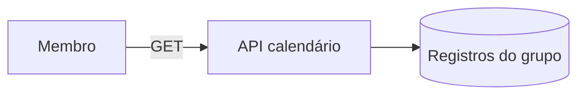

# Modelo de ameaças — Calendário

## Ativos e dados
| Ativo | Classificação | Por que importa |
|---|---|---|
| Estado dos dias de cada pessoa | pessoal | revela o hábito de escrita; só o grupo vê |
| Horários de entrega | pessoal | revelam rotina; não saem na API |
| Data de entrada no grupo | pessoal | só o sistema |

## Fronteiras de confiança e fluxo de dados

## Ameaças (STRIDE por fluxo)
| ID | Fluxo | STRIDE | Ameaça | Prob. | Impacto | Risco | Controle(s) |
|---|---|---|---|---|---|---|---|
| THR-71 | rota | I | membro lê o calendário de outro grupo ou meses fora do intervalo | B | M | B | CTL-71 |
| THR-72 | rota | I | a resposta revela horário, texto ou visibilidade de um registro `private` | M | M | M | CTL-72 |
| THR-73 | cálculo | T | entrega perto da meia-noite cai no dia errado e gera falha injusta | M | M | M | CTL-73 |
| THR-74 | rota | D | mês muito antigo ou pedidos repetidos pesam no banco | B | B | B | CTL-74 |

## Controles
| ID | Controle | Atende | Teste/evidência |
|---|---|---|---|
| CTL-71 | consulta sempre filtrada pelo grupo da pessoa; mês validado (formato, futuro, antes da entrada) | THR-71, ABU-19, REQ-16.7 | `test_abu_19_*`, `test_req_16_7_*` |
| CTL-72 | resposta mínima: estados, nome, cor; teste prova ausência de horário, texto, visibilidade e e-mail | THR-72, REQ-16.6 | `test_req_16_6_*` |
| CTL-73 | usa `Registro.data` (dia de São Paulo, gravado na entrega); oráculo independente e casos de borda | THR-73, REQ-16.9, ABU-20, PROP-11 | `test_abu_20_*`, `test_prop_11_*` |
| CTL-74 | no máximo 3 consultas por pedido; mês limitado ao intervalo do grupo | THR-74, NFR-CAL-3 | `test_nfr_cal_3_*` |

## Riscos residuais
O estado `escreveu` de um registro `private` é visível ao parceiro (decisão registrada). O fuso fixo pode errar o dia de quem está em outro fuso.
