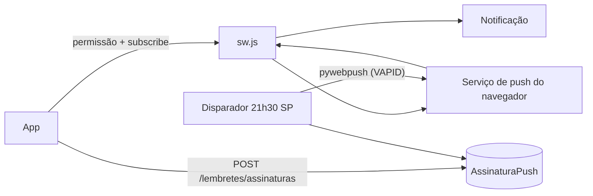

# Design — Lembretes (PWA e Web Push)

## 1. Visão geral
App Django `lembretes` (assinaturas, envio, comando do disparador) e um serviço de compose, `entrelinhas-lembretes`, que roda a mesma imagem da API com o comando
`manage.py rodar_lembretes`. No front: manifesto completo, `web/sw.js` (só push) e a seção de lembrete em Perfil.

## 2. Reuso e impacto
- Reusa `acesso` (usuário), `registros` (quem entregou hoje, por `Registro.data`), sessão e CSRF.
- Compose: serviço novo (sem porta, sem rótulos do Traefik, sem rota pública), variáveis `VAPID_*` e segredos do GitHub no `.env.production`; `deploy.sh` confere a presença das chaves antes de parar a API (como faz com o administrador).
- nginx: `sw.js` servido com `Cache-Control: no-cache` e `Service-Worker-Allowed: /entrelinhas/`.
- `pubspec`/Flutter: **nenhum pacote novo**; a ponte com `Notification`, `serviceWorker` e `PushManager` usa `dart:js_interop` (SDK), atrás de uma interface (`PushApi`) para os testes.
- Backend: dependência `pywebpush` (ADR-0012), travada em `uv.lock`.

## 3. Pesquisa
- Web Push exige HTTPS, service worker, permissão por gesto do usuário e chave VAPID (RFC 8292); o corpo é cifrado (RFC 8291), tarefa da biblioteca.
- iOS: só PWA instalado (16.4+); o app detecta e orienta.
- Serviços de push conhecidos para a lista: `fcm.googleapis.com`, `updates.push.services.mozilla.com`, `web.push.apple.com`, `*.push.apple.com`, `*.notify.windows.com`.
- `pywebpush.webpush(subscription_info, data, vapid_private_key, vapid_claims, timeout)`: 404/410 vêm em `WebPushException.response.status_code`.
- Idempotência: inserir `LembreteEnviado(usuario, data)` com `unique` **antes** de enviar (no máximo uma vez: falha de rede no envio não repete no mesmo dia, REQ-19.8).
- Janela de atraso: `21:30 ≤ agora_SP < 23:00`.

## 4. Modelo de dados
| Modelo | Campos |
|---|---|
| `AssinaturaPush` | `id` UUID PK · `usuario` FK · `endpoint` TEXT (único) · `p256dh` · `auth` · `criada_em` |
| `LembreteEnviado` | `id` · `usuario` FK · `data` DATE · `enviado_em` · `unique(usuario, data)` |
Limpeza: `LembreteEnviado` com mais de 30 dias é apagado pelo próprio disparador, uma vez por dia.

## 5. Contratos
`contracts/openapi.yaml`. Rotas de `/api/v1`:
| Método e rota | O que faz |
|---|---|
| `GET /lembretes/chave-publica` | `{chave}` (chave pública VAPID, base64url) |
| `POST /lembretes/assinaturas` `{endpoint, keys:{p256dh, auth}}` | guarda; 201 |
| `DELETE /lembretes/assinaturas` `{endpoint}` | remove a do próprio usuário; 204 |
Comando: `manage.py rodar_lembretes` (laço), `manage.py enviar_lembretes --agora ISO` (uma execução, para teste e uso manual), `manage.py gerar_vapid` (imprime o par; não grava).

## 6. Fluxos e estados de UI
Perfil → "Lembrete diário às 21h30": chave de liga/desliga + texto de estado. Ligar: permissão → registrar SW → assinar → enviar. Estados: desligado, ligado neste aparelho, bloqueado (como liberar), sem suporte
(iPhone: "instale o app na tela inicial: Compartilhar → Adicionar à Tela de Início"). Notificação: título "Entrelinhas", corpo "Hora de escrever o seu dia.", toque abre `#/hoje`.

## 7. Tratamento de erros
| Situação | Resposta |
|---|---|
| Endereço fora da lista, não HTTPS, chaves inválidas | 422, sem chamar o endereço |
| 6ª assinatura | 409 |
| Assinatura de outro usuário | 404 |
| Falha do push (404/410) | assinatura removida; (5xx/rede) registrada, sem repetição no dia |

## 8. Propriedades de corretude
PROP-13: relógio e envio injetados; sorteio de pessoas, assinaturas, entregas e instantes; o conjunto enviado bate com o oráculo (regras 19.1, 19.2, 19.5) e uma segunda execução envia vazio.

## 9. Segurança (resumo — detalhe em threat-model.md)
Lista fixa de serviços de push (SSRF); chaves VAPID só em segredo; mensagem genérica; sw sem cache de dados; autorização por objeto; idempotência no banco; dependência verificada.

## 10. Estratégia de testes
Testes `[010]` em `backend/apps/lembretes/tests/`, `backend/tests/` e `frontend/test/`. Mocks só na fronteira externa (o `webpush` e o relógio).
| Teste | Prova |
|---|---|
| `test_req_18_3_*`, `18_4_*` (inclui IPs internos, `localhost`, `http`, `https` de domínio fora da lista, redirecionamentos), `18_5_*`, `18_6_*` | US-18 servidor, ABU-21 |
| `test_abu_22_*` | ABU-22 |
| `test_req_19_1_*` a `19_6_*`, `19_8_*` | US-19 |
| `test_abu_23_*` (dois processos com threads; reinício) | ABU-23, REQ-19.3 |
| `test_prop_13_*` | PROP-13 |
| `test_nfr_lemb_1_*` (a chave privada não está em nenhuma resposta, log nem no repositório) | NFR-LEMB-1 |
| `test_ctl_83_*`, `test_ctl_84_*` (texto do compose e do deploy: serviço sem porta e sem rótulos; chaves exigidas) | CTL-83, CTL-84 |
| Flutter: `lembrete_test.dart` com `PushApi` falsa (estados, permissão negada, iPhone) e `manifesto_test.dart` (campos do manifesto, ícones existem) | REQ-18.1, 18.2, 18.6 a 18.8, NFR-LEMB-4 |
| JS: teste do `sw.js` em Node (eventos `push` e `notificationclick` simulados; sem `fetch`/cache) | REQ-19.7, NFR-LEMB-2 |
| Manual no ar, em celular real (Android Chrome e iPhone instalado) | REQ-19.1, 19.7 (evidência no `validation.md`; não há push real local) |

## 11. Observabilidade
Log do disparador: contagem de avisos enviados, removidos e com falha por execução; nunca endpoint, chaves, nome ou conteúdo. Saúde: arquivo de batimento atualizado a cada tick; o `healthcheck` falha se passar de 2 min.

## 12. Decisões
| ADR | Decisão |
|---|---|
| ADR-0012 | `pywebpush` para o envio; disparador como serviço do compose; VAPID em segredos |

## 13. Portões da constituição
| Art. | Atende? |
|---|---|
| 4 Simplicidade | **exceção justificada:** segundo contêiner, da mesma imagem da API (não é um terceiro projeto implantável); ver §14 |
| 5 | sim: a biblioteca é usada direto |
| 6 | sim |
| 7 | sim: lista fixa de destinos; objeto por dono |
| 9 | sim: sem conteúdo em log nem em notificação |
| 11 | sim: ADR-0012 |
| 12 | sim: a notificação é genérica; o sw não guarda dados |

## 14. Rastreamento de complexidade
| Exceção | Por quê | Alternativa mais simples descartada |
|---|---|---|
| Serviço `entrelinhas-lembretes` (mesma imagem) | aviso diário precisa de um relógio fora das requisições | cron na VPS (estado e deploy em dois lugares) |

## 15. Riscos e rollback
Risco: serviço de push mudar domínio (a lista fica desatualizada; ajuste via mudança). Risco: sem push real nos testes locais (provado só no ar). Risco: segredo VAPID vazar (rotacionar e pedir nova assinatura).
Rollback: remover o serviço e as rotas; o app esconde a seção; reverter a migração.
