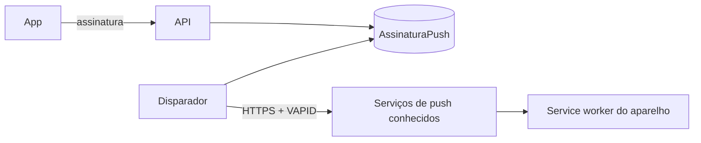

# Modelo de ameaças — Lembretes (PWA e Web Push)

## Ativos e dados
| Ativo | Classificação | Por que importa |
|---|---|---|
| Chave privada VAPID | segredo | quem a tem envia avisos em nome do app |
| Assinaturas de push (endpoint e chaves) | pessoal | permitem enviar notificação ao aparelho da pessoa |
| Texto da notificação | pessoal | aparece na tela bloqueada |
| Service worker | interno | roda com privilégio na origem; um sw adulterado intercepta tudo |

## Fronteiras de confiança e fluxo de dados

## Ameaças (STRIDE por fluxo)
| ID | Fluxo | STRIDE | Ameaça | Prob. | Impacto | Risco | Controle(s) |
|---|---|---|---|---|---|---|---|
| THR-81 | assinatura → disparador | T/I | SSRF: o usuário informa como endpoint um endereço interno ou de terceiros e o servidor o chama | M | A | A | CTL-81 |
| THR-82 | assinatura | E | pessoa lê ou remove assinatura de outra | B | M | B | CTL-82 |
| THR-83 | infra | I | chave privada VAPID vaza (git, log, resposta, imagem) | B | A | M | CTL-83 |
| THR-84 | infra | E | o disparador ganha porta pública ou rota do Traefik, ou roda sem verificação das chaves | B | M | B | CTL-84 |
| THR-85 | notificação | I | texto da notificação mostra nome ou conteúdo do diário na tela bloqueada | M | A | A | CTL-85 |
| THR-86 | disparo | D | aviso duplicado ou em massa por reinício, dois processos ou laço sem trava | M | B | B | CTL-86 |
| THR-87 | service worker | T | sw guarda dados em cache ou intercepta pedidos e expõe conteúdo do diário | B | A | M | CTL-87 |
| THR-88 | cadeia de suprimentos | T | `pywebpush` ou dependência transitiva adulterada | B | A | M | CTL-88 |

## Controles
| ID | Controle | Atende | Teste/evidência |
|---|---|---|---|
| CTL-81 | validar o endpoint: só HTTPS, host na lista fixa de serviços de push, sem IP literal, sem porta estranha, sem credencial na URL; recusa antes de qualquer chamada; envio com tempo limite | THR-81, ABU-21, REQ-18.4 | `test_req_18_4_*`, `test_abu_21_*` |
| CTL-82 | assinatura sempre filtrada pelo usuário; de outro, 404 | THR-82, ABU-22 | `test_abu_22_*` |
| CTL-83 | chaves em segredos do GitHub e `.env.production` (modo 600); só a chave pública sai pela API; nada em log; comando `gerar_vapid` só imprime | THR-83, NFR-LEMB-1 | `test_nfr_lemb_1_*`, `test_ctl_83_*` |
| CTL-84 | serviço sem `ports` e sem rótulos do Traefik; `deploy.sh` exige as chaves antes de parar a API | THR-84, NFR-LEMB-3 | `test_ctl_84_*` |
| CTL-85 | texto fixo e genérico no servidor; sem nome, sem conteúdo | THR-85, REQ-19.6 | `test_req_19_6_*` |
| CTL-86 | `unique(usuario, data)` inserido antes do envio; no máximo uma vez por dia; teste com threads | THR-86, REQ-19.3, ABU-23 | `test_abu_23_*`, `test_prop_13_*` |
| CTL-87 | sw só trata `push` e `notificationclick`, sem `fetch` com cache nem `caches.*`; `no-cache` e escopo no nginx | THR-87, NFR-LEMB-2 | teste do `sw.js` em Node; `test_ctl_87_*` (nginx) |
| CTL-88 | ADR-0012, versão travada, verificação no PyPI, `pip-audit` rodado e anotado no `validation.md` | THR-88 | `uv.lock`; evidência |

## Riscos residuais
- O serviço de push (Google, Mozilla, Apple) sabe que existe uma assinatura e quando enviamos; o conteúdo vai cifrado e é genérico.
- Notificação na tela bloqueada revela que existe um app de diário no aparelho; é escolha da pessoa ligar o lembrete.
- Sem prova de entrega real nos testes locais; só no ar, em celular real.
