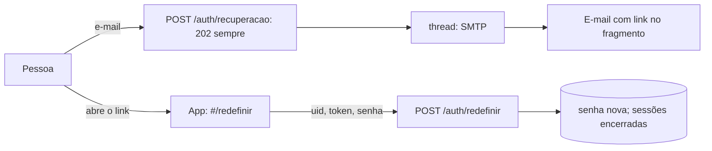

# Design — Recuperação de senha por e-mail

## 1. Visão geral
Duas rotas públicas novas no app `acesso`: `POST /auth/recuperacao` e `POST /auth/redefinir`. O e-mail sai por SMTP em uma thread de segundo plano. O front ganha duas telas
alcançadas por links públicos (`#/recuperar` e `#/redefinir/<uid>/<token>`).

## 2. Reuso e impacto
- Reusa `SessaoComCsrf`, a política de senha, o encerramento de sessões da 003 (REQ-4.6) e o padrão de resposta uniforme (ABU-2/3).
- As duas rotas **entram na lista de públicas** (`test_rotas_publicas`) e no roteador do Traefik com o balde de 5 por minuto (novos roteadores `entrelinhas-recuperar-*` usando o middleware `entrelinhas-entrar-limite` já existente).
- Settings: `EMAIL_*`, `DEFAULT_FROM_EMAIL`, `APP_URL_BASE`, `PASSWORD_RESET_TIMEOUT = 3600`. Compose e `deploy.sh`: variáveis exigidas (NFR-REC-4). O GitHub guarda `EMAIL_HOST_PASSWORD` como segredo.
- Front: botão em Entrar e duas telas; rotas anônimas no redirecionamento.
- Sem pacote novo (Django traz SMTP e o gerador de tokens).

## 3. Pesquisa
- `django.contrib.auth.tokens.default_token_generator`: hash sobre `pk`, senha, `last_login` e carimbo de tempo; `PASSWORD_RESET_TIMEOUT` em segundos. Muda a senha ou entra de novo → token antigo morre (REQ-21.5).
- `urlsafe_base64_encode(force_bytes(pk))` para o `uid`.
- `EmailMessage.send(fail_silently=False)` dentro da thread, com `timeout` do SMTP; `connection` aberta por mensagem (volume mínimo).
- Cabeçalho `Host`: o link usa `APP_URL_BASE`, o que também fecha o ataque de "envenenamento do cabeçalho Host".
- Resposta e tempo: o único trabalho dentro do pedido é consultar o usuário e gravar o contador; envio vai a uma thread de segundo plano (`threading.Thread(daemon=True)`).
- Limite por hora: tabela `PedidoRecuperacao(usuario, criado_em)`; conta pedidos dos últimos 60 min; pedido acima do limite não grava nem envia.

## 4. Modelo de dados
| Modelo | Campos |
|---|---|
| `PedidoRecuperacao` | `id` · `usuario` FK (`CASCADE`) · `criado_em` · índice `(usuario, criado_em)` |
Limpeza: pedidos com mais de 24 h são apagados quando um novo pedido da mesma conta chega (e pelo `limpar_pedidos` no deploy).

## 5. Contratos
`contracts/openapi.yaml`. Rotas de `/api/v1` (públicas, com CSRF):
| Método e rota | O que faz |
|---|---|
| `POST /auth/recuperacao` `{email}` | 202 `{"detalhe":"Se este e-mail tiver conta, enviamos um link. Vale por 1 hora."}` sempre |
| `POST /auth/redefinir` `{uid, token, nova_senha}` | 204; 400 `{"detalhe":"Link inválido ou vencido."}`; 422 `{"campos":{"nova_senha":[…]}}` |
E-mail do link: assunto "Entrelinhas — redefinir senha", corpo curto, o link e "Se não foi você, ignore". E-mail de aviso: "Sua senha foi alterada".

## 6. Fluxos e estados de UI
Entrar → "Esqueci minha senha" → campo de e-mail → enviar → confirmação fixa. Link → tela de senha nova (senha e confirmação, regras visíveis, mostrar/ocultar) → sucesso → Entrar com mensagem. Link inválido → mensagem e botão "Pedir outro link".
O app lê `uid` e `token` do fragmento, guarda só em memória e troca a rota para uma sem o token (REQ-22.6).

## 7. Tratamento de erros
Pedido: nunca erro visível além de rede ("Sem conexão."). Redefinir: 400 uniforme, 422 de senha. Falha de SMTP: só log (sem e-mail, token ou corpo).

## 8. Propriedades de corretude
PROP-14: lista de entradas (existente, inexistente, maiúsculas, espaços, vazio, repetido acima do limite, formato inválido); status, corpo e cabeçalhos relevantes são idênticos; o envio só ocorre para a existente dentro do limite.

## 9. Segurança (resumo — detalhe em threat-model.md)
Resposta uniforme; envio fora do pedido; link com base de configuração; token do Django com 1 h e uso único; sessões encerradas; limite por conta e por origem; aviso por e-mail; segredos de SMTP só em ambiente.

## 10. Estratégia de testes
Testes `[011]` em `backend/apps/acesso/tests/`, `backend/tests/` e `frontend/test/`. Mock só na fronteira externa (SMTP: `locmem` do Django, e um backend lento para o teste de tempo).
| Teste | Prova |
|---|---|
| `test_req_20_1_*`, `20_2_*`, `20_6_*` | US-20 |
| `test_req_20_3_*` e `test_abu_27_*` (Host e X-Forwarded-Host falsos) | REQ-20.3, ABU-27 |
| `test_req_20_4_*` (SMTP lento de 2 s: a resposta não espera) | REQ-20.4 |
| `test_req_20_5_*` (falha de envio sem vazar e-mail nem token no log) | REQ-20.5 |
| `test_req_21_1_*` a `21_5_*` (vencido com relógio injetado, reuso, `uid` trocado, senha fraca mantém o token) | US-21, ABU-26 |
| `test_abu_24_*`, `test_prop_14_*` | ABU-24, PROP-14 |
| `test_abu_25_*` | ABU-25 |
| `test_nfr_rec_1_*`, `test_nfr_rec_4_*` (texto do deploy e do compose) | NFR-REC-1, NFR-REC-4 |
| `test_rotas_publicas` (atualizado) e `test_ctl_92_*` (roteadores do Traefik com limite) | CTL-91, CTL-92 |
| Flutter: `recuperacao_test.dart` | REQ-22.1 a 22.6, NFR-REC-3 |
| Medição no ar: 429 do 6º pedido em 1 min; e-mail real recebido; link usado (evidência no `validation.md`) | REQ-20.1, ABU-25 |

## 11. Observabilidade
Log de auditoria: "recuperação pedida (conta id)", "senha redefinida (conta id)"; nunca e-mail, token ou corpo.

## 12. Decisões
| ADR | Decisão |
|---|---|
| ADR-0013 | recuperação por token do Django, link no fragmento, SMTP, resposta uniforme |

## 13. Portões da constituição
| Art. | Atende? |
|---|---|
| 4, 5 | sim: Django direto, sem pacote |
| 6 | sim |
| 7 | sim: rotas públicas declaradas e limitadas |
| 9 | sim: sem dado sensível em log |
| 11 | sim: sem dependência nova |

## 14. Rastreamento de complexidade
Sem exceção (a thread de segundo plano é a forma mais simples de não vazar tempo; sem fila externa).

## 15. Riscos e rollback
Risco: provedor de e-mail marcar como spam (testar com os dois e-mails reais; SPF/DKIM do provedor). Risco: quem controla o e-mail controla a conta (aceito; sessões encerradas e aviso por e-mail mitigam).
Risco: thread perder e-mail se o processo cair no meio (o usuário pede de novo). Rollback: retirar as rotas e o botão; reverter a migração.
