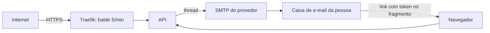

# Modelo de ameaças — Recuperação de senha por e-mail

## Ativos e dados
| Ativo | Classificação | Por que importa |
|---|---|---|
| Conta e senha | segredo | a conta dá acesso ao diário íntimo |
| Token de redefinição | segredo de curta duração | quem o tem troca a senha |
| E-mail da conta | pessoal | canal de recuperação; quem o controla controla a conta |
| Credenciais SMTP | segredo | enviam e-mail em nome do app |

## Fronteiras de confiança e fluxo de dados

## Ameaças (STRIDE por fluxo)
| ID | Fluxo | STRIDE | Ameaça | Prob. | Impacto | Risco | Controle(s) |
|---|---|---|---|---|---|---|---|
| THR-91 | pedido | I | descobrir quais e-mails têm conta (conteúdo, código, tempo ou limite diferentes) | M | M | M | CTL-91 |
| THR-92 | pedido | S/T | cabeçalho `Host` ou `X-Forwarded-Host` falso faz o e-mail trazer um link para o domínio do atacante | M | A | A | CTL-92 |
| THR-93 | redefinição | S | adivinhar, reutilizar ou usar token vencido; trocar o `uid` | B | A | M | CTL-93 |
| THR-94 | pedido | D | encher a caixa de e-mail de outra pessoa ou o provedor com pedidos | M | M | M | CTL-94 |
| THR-95 | e-mail | E | quem comprometeu a caixa de e-mail toma a conta | M | A | A | CTL-95 |
| THR-96 | infra | I | credenciais SMTP vazam (git, log, imagem) | B | A | M | CTL-96 |
| THR-97 | link e log | I | token vaza por log, `Referer`, histórico ou armazenamento do navegador | M | A | A | CTL-97 |

## Controles
| ID | Controle | Atende | Teste/evidência |
|---|---|---|---|
| CTL-91 | resposta 202 única; envio fora do pedido; rota pública declarada e limitada; mesma resposta para limite estourado, e-mail inexistente e inválido | THR-91, ABU-24, REQ-20.2, REQ-20.4, PROP-14 | `test_prop_14_*`, `test_req_20_4_*`, `test_rotas_publicas` |
| CTL-92 | link montado só com `APP_URL_BASE`; roteadores do Traefik com o balde de 5 por minuto | THR-92, ABU-27, REQ-20.3 | `test_abu_27_*`, `test_ctl_92_*` |
| CTL-93 | token do Django com 1 hora; morre ao trocar a senha ou entrar; erro único de 400 | THR-93, ABU-26, REQ-21.2, REQ-21.5 | `test_req_21_2_*`, `test_req_21_5_*`, `test_abu_26_*` |
| CTL-94 | 3 pedidos por conta por hora (silencioso) e balde no Traefik | THR-94, ABU-25, REQ-20.6 | `test_abu_25_*`, `test_ctl_92_*` |
| CTL-95 | ao redefinir: sessões encerradas, sem login automático, e-mail de aviso; token curto | THR-95, REQ-21.1, REQ-21.4 | `test_req_21_1_*`, `test_req_21_4_*` |
| CTL-96 | senha SMTP só em segredo do GitHub e `.env.production`; o deploy exige as variáveis; nada em log | THR-96, NFR-REC-1, NFR-REC-4 | `test_nfr_rec_1_*`, `test_nfr_rec_4_*` |
| CTL-97 | token no fragmento (não vai ao servidor nem ao `Referer`); log sem corpo, e-mail nem token; app tira o token da barra e não grava nada | THR-97, REQ-20.5, REQ-22.6 | `test_req_20_5_*`, `recuperacao_test.dart` |

## Riscos residuais
- **Quem controla a caixa de e-mail controla a conta** (aceito, comum a todo sistema com recuperação por e-mail): sessões encerradas e aviso por e-mail dão chance de reagir.
- O provedor de e-mail vê o link e o horário. O conteúdo é só o link de uso único e vida curta.
- E-mail pode cair em spam; a evidência da 5.2 confirma a entrega nos dois e-mails reais.
